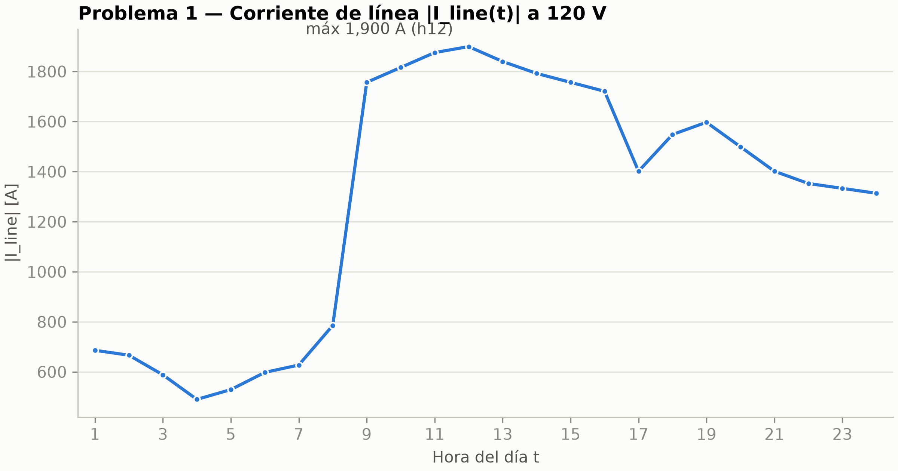
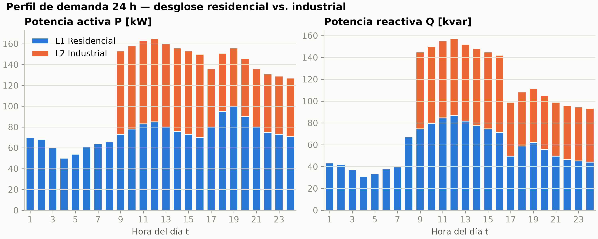
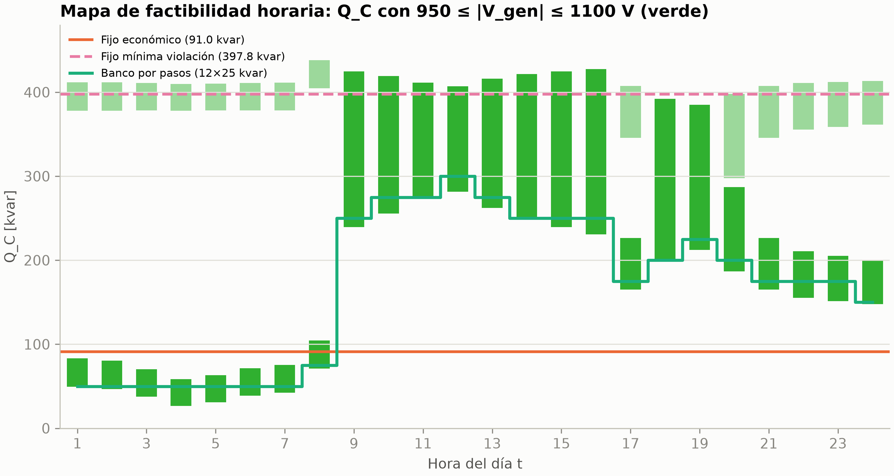
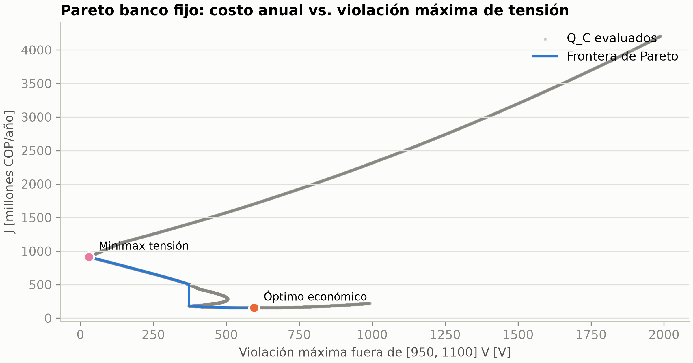
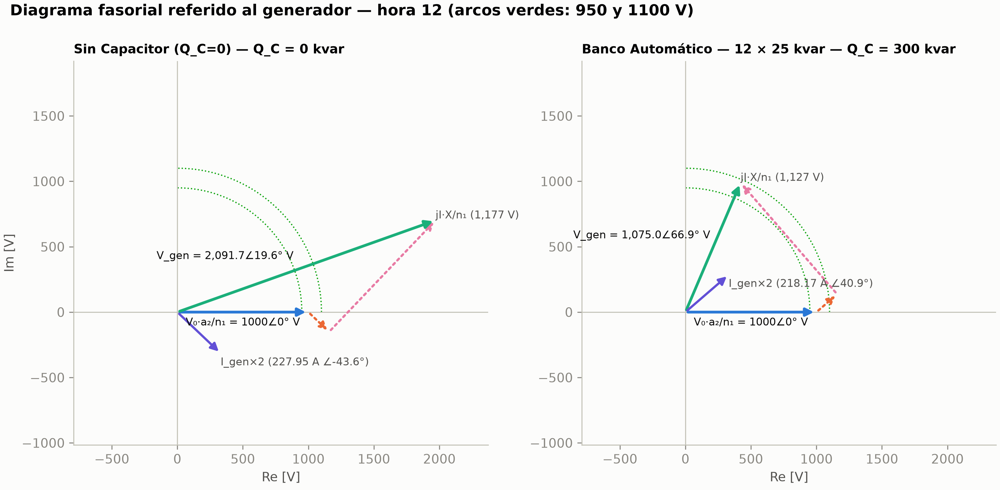
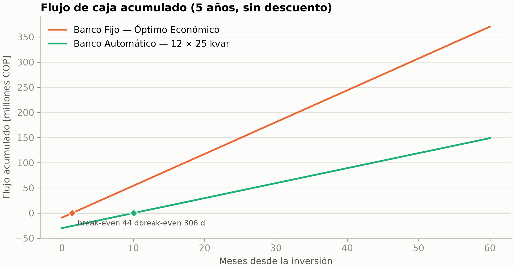
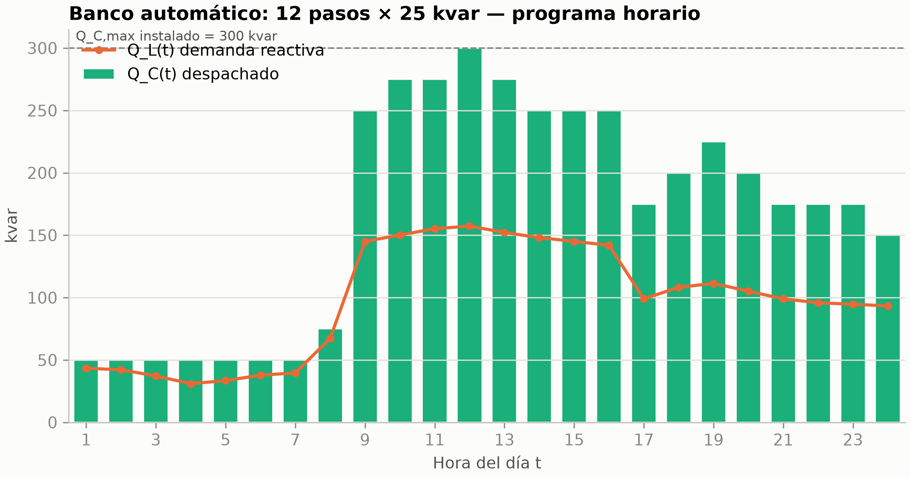
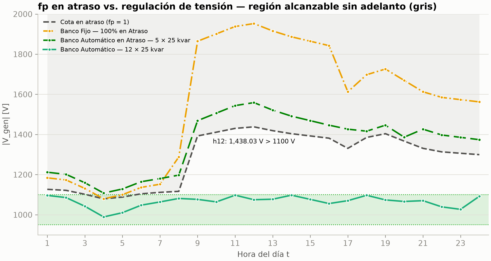
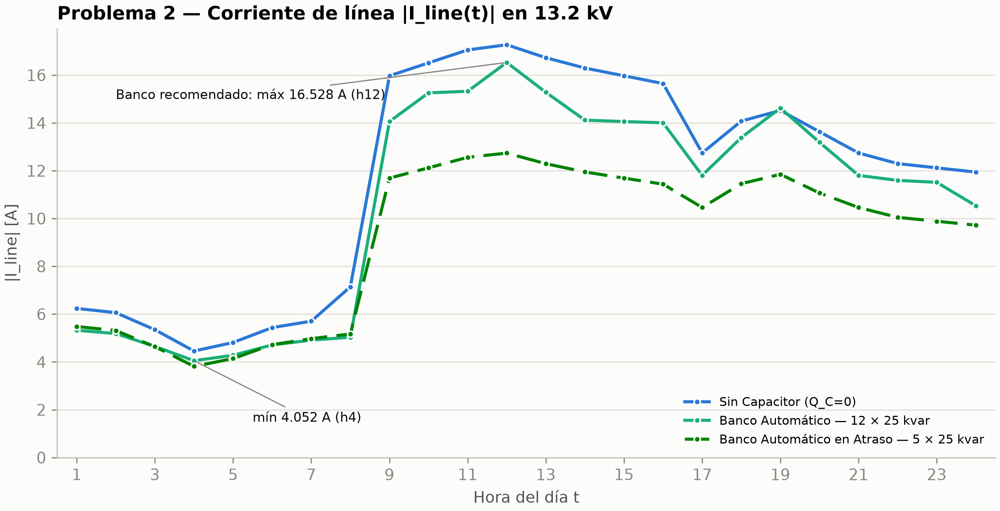

# Resumen de sustentación — Análisis fasorial y optimización de bancos de capacitores

> Generado automáticamente por `scripts/run_full_analysis.py`. Todos los valores provienen del solucionador
> verificado por `pytest` (Golden Test hora 1 y conservación exacta de potencia compleja).

## 1. Datos del sistema

- V₀ = 120∠0° V · R_gen = 0.5 Ω · Z_line = 80 + j900 Ω · T1 = 1:13.2 · T2 = 110:1
- Tarifa = 960 COP/kWh · 365 días/año · Banco = 100 000 COP/kvar · Banda |V_gen| ∈ [950, 1100] V
- Energía diaria demandada: **2,863 kWh** · Demanda reactiva media: **97.2286 kvar**
- Todas las cargas de la Tabla 1 se modelan en atraso: Q_k = +P_k·tan(arccos(pf_k)).

**Transformadores del Problema 2**

- **T1 — Transformador Elevador (1 kV : 13.2 kV, n₁ = 13.2):** ubicado a la salida del generador; eleva la tensión
  para transportar la potencia con menor corriente y reducir las pérdidas I²R en la línea.
- **T2 — Transformador Reductor (13.2 kV : 120 V, a₂ = 110):** ubicado junto a la barra de carga; reduce la tensión
  de 13.2 kV a V₀ = 120∠0° V para alimentar L1 (residencial) y L2 (industrial).

## 2. Problema 1 — Red directa a 120 V

| Magnitud (hora 1) | Valor |
|---|---:|
| \|I_line(1)\| | 686.2745098 A ∠ -31.78833062° |
| P_loss(1) | 37,913.30258 kW |
| Q_loss(1) | 423,875.4325 kvar |
| \|S_gen(1)\| | 425,617.0728 kVA |

- Corriente máxima: **1,899.54 A** (hora 12).
- Pérdidas diarias: **3,684,396.45 kWh** frente a 2,863 kWh útiles
  (×1,287).
- **Problema 1 (b) — costo de las pérdidas:** 3,684,396.4517 kWh/día × 960 COP/kWh =
  **$ 3.537.020.594 COP/día** (exacto: 3,537,020,593.64 COP; con E_loss redondeada a
  3,684,396 kWh: $ 3.537.020.160 COP/día) → **$ 1.291.012.516.679 COP/año**.
- Conclusión: distribuir a 120 V a través de 80 + j900 Ω es inviable; se requiere elevar la tensión.

## 3. Problema 2 — Red con transformadores (Q_C = 0)

- R_eq referida al lado de 13.2 kV = 80 + 0.5·13.2² = **167.12 Ω** (verificado).
- Corriente de línea máxima: **17.2686 A** (reducción ×110).
- Pérdidas diarias: **632.1404 kWh** → OPEX anual **$ 221.501.988 COP**.
- \|V_gen\| ∈ [1229.4, 2091.7] V → **24/24 h fuera de banda**.

### 3.1 Respuesta directa a los literales (a)–(e) del Problema 2

**(a) Metodología y criterios.** T1 (elevador 1 kV : 13.2 kV, n₁ = 13.2) a la salida del generador y T2 (reductor
13.2 kV : 120 V, a₂ = 110) junto a la barra de carga. Se resuelve el flujo fasorial hora a hora
(I_load = conj(S_neto/V₀), I_line = I_load/a₂, I_gen = n₁·I_line, V_gen = (V₀·a₂ + I_line·Z_line)/n₁ + R_gen·I_gen).
Criterios de decisión: (1) costo total anual J = OPEX de pérdidas (960 COP/kWh × 365 d) + CAPEX (100 000 COP/kvar);
(2) restricción dura 950 ≤ \|V_gen\| ≤ 1100 V las 24 h (análisis cuadrático exacto); (3) requisito operativo
de fp neto en atraso (Q_net ≥ 0), analizado aparte por ser físicamente incompatible con (2) en horas pico.

**(b) Costo final del banco y recomendación.**

| Alternativa | Q_C instalado | Costo del banco (CAPEX) | J anual | Cumple [950, 1100] V | fp neto |
|---|---:|---:|---:|---:|---:|
| Banco Automático — 12 × 25 kvar | 300.0000 kvar | $ 30.000.000,00 COP | $ 215.726.295 COP | 24/24 h | 24 h en adelanto |
| Banco Automático en Atraso — 5 × 25 kvar | 125.0000 kvar | $ 12.500.000,00 COP | $ 144.629.847 COP | 0/24 h | 24/24 h en atraso |
| Banco Fijo — 100% en Atraso | 30.9872 kvar | $ 3.098.721,69 COP | $ 183.742.766 COP | 2/24 h | 24/24 h en atraso |
| Banco Fijo — Óptimo Económico | 91.0297 kvar | $ 9.102.971,01 COP | $ 154.664.177 COP | 1/24 h | 8 h en adelanto |

**Recomendación:** banco automático **12 × 25 kvar = 300 kvar**, costo
**$ 30.000.000 COP**: es la única alternativa que cumple la restricción de tensión las 24 h, con ahorro de
$ 35.775.693 COP/año y payback de 306.1 días. Si el operador exige fp en atraso, la
alternativa es el banco en atraso 5 × 25 kvar ($ 12.500.000 COP, J mínimo),
aceptando que \|V_gen\| ∈ [1108.04, 1558.86] V queda fuera de la banda (teorema §5.4).

**(c) \|I_line(t)\| (Fig. 17).** Q_C = 0: 4.4563–17.2686 A;
banco recomendado: 4.0525–16.5278 A; reducción frente al máximo
del Problema 1 (1,899.54 A): ×114.9.

**(d) \|V_gen(t)\| con banda (Fig. 6, 9 y 16).** Banco recomendado: \|V_gen\| ∈ [989.18,
1097.62] V, 24/24 h en banda. Ningún Q_C fijo sirve: la hora 8 y la hora
19 exigen conjuntos disjuntos de Q_C (§4).

**(e) P_loss(t) (Fig. 7).** Banco recomendado: **530.0408 kWh/día**
(253.7294 kWh en R_line = 47.87 %, 276.3114 kWh en R_gen = 52.13 %),
costo anual **$ 185.726.295 COP** (Q_C = 0: 632.1404 kWh/día → $ 221.501.988 COP/año).

## 4. Diagnóstico exacto de factibilidad (banco fijo)

\|V_gen(t,Q_C)\|² = a·Q_C² + b(t)·Q_C + c(t) es una parábola convexa ⇒ cada hora admite 1 o 2 intervalos
cerrados (rama inductiva y rama sobrecompensada). Solución analítica verificada numéricamente
(malla de 40 001 puntos + `brentq`): desviación máxima **2.44e-12 kvar**.

| Hora | Q_C factible [kvar] |
|---:|---:|
| 1 | [49.235, 83.131] ∪ [377.928, 411.823] |
| 2 | [46.855, 80.490] ∪ [378.089, 411.725] |
| 3 | [37.617, 70.315] ∪ [378.349, 411.047] |
| 4 | [26.673, 58.396] ∪ [377.873, 409.596] |
| 5 | [30.973, 63.062] ∪ [378.164, 410.254] |
| 6 | [38.747, 71.554] ∪ [378.349, 411.156] |
| 7 | [42.180, 75.327] ∪ [378.294, 411.442] |
| 8 | [70.933, 104.320] ∪ [404.641, 438.028] |
| 9 | [239.494, 424.857] |
| 10 | [255.500, 419.052] |
| 11 | [273.567, 411.187] |
| 12 | [281.650, 407.186] |
| 13 | [262.425, 416.208] |
| 14 | [248.897, 421.574] |
| 15 | [239.494, 424.857] |
| 16 | [230.589, 427.641] |
| 17 | [164.935, 226.590] ∪ [345.638, 407.293] |
| 18 | [198.783, 392.038] |
| 19 | [212.170, 384.847] |
| 20 | [186.626, 287.009] ∪ [297.614, 397.997] |
| 21 | [164.935, 226.590] ∪ [345.638, 407.293] |
| 22 | [155.082, 210.727] ∪ [355.304, 410.948] |
| 23 | [151.292, 205.064] ∪ [358.487, 412.259] |
| 24 | [147.582, 199.693] ∪ [361.380, 413.491] |

- **Intersección global 24 h: ∅ → INFACTIBLE.**
- Pares de horas en conflicto: (8, 18), (8, 19), (8, 20) (par crítico (8, 19)).
  La hora 8 exige Q_C ∈ [70.933, 104.320] ∪ [404.641, 438.028] kvar, mientras la hora 19 exige Q_C ∈ [212.170, 384.847] kvar: los conjuntos son disjuntos, luego la intersección de las 24 h es vacía.

## 5. Comparativa de estrategias

| Estrategia | Q_C inst. [kvar] | I_line máx [A] | E_loss [kWh/día] | CAPEX | OPEX anual | J anual | Ahorro anual | Payback [días] | V_gen mín–máx [V] | Horas fuera | Viol. máx [V] | fp_neto mín–máx | Estado fp (24 h) |
|---:|---:|---:|---:|---:|---:|---:|---:|---:|---:|---:|---:|---:|---:|
| Sin Capacitor (Q_C=0) | 0.000 | 17.269 | 632.140 | $ 0 COP | $ 221.501.988 COP | $ 221.501.988 COP | $ 0 COP | 0,0 | 1229.4–2091.7 | 24 | 991.72 | 0.700–0.850 | 24/24 h en atraso |
| Banco Fijo — Óptimo Económico | 91.030 | 13.470 | 415.414 | $ 9.102.971 COP | $ 145.561.206 COP | $ 154.664.177 COP | $ 75.940.783 COP | 43,8 | 802.6–1695.1 | 23 | 595.09 | 0.640–1.000 | 8 h en adelanto |
| Banco Fijo — Mínima Violación de Tensión | 397.780 | 28.044 | 2493.891 | $ 39.778.022 COP | $ 873.859.421 COP | $ 913.637.443 COP | -$ 652.357.433 COP | ∞ | 920.3–1129.7 | 3 | 29.71 | 0.135–0.566 | 24 h en adelanto |
| Banco Automático — 12 × 25 kvar | 300.000 | 16.528 | 530.041 | $ 30.000.000 COP | $ 185.726.295 COP | $ 215.726.295 COP | $ 35.775.693 COP | 306,1 | 989.2–1097.6 | 0 | 0.00 | 0.756–0.996 | 24 h en adelanto |
| Banco Fijo — 100% en Atraso | 30.987 | 15.741 | 515.537 | $ 3.098.722 COP | $ 180.644.045 COP | $ 183.742.766 COP | $ 40.857.944 COP | 27,7 | 1079.3–1952.6 | 22 | 852.60 | 0.794–1.000 | 24/24 h en atraso |
| Banco Automático en Atraso — 5 × 25 kvar | 125.000 | 12.737 | 377.083 | $ 12.500.000 COP | $ 132.129.847 COP | $ 144.629.847 COP | $ 89.372.141 COP | 51,1 | 1108.0–1558.9 | 24 | 458.86 | 0.967–0.999 | 24/24 h en atraso |
| Banco Automático — Control Continuo (ideal) | 281.650 | 15.654 | 495.034 | $ 28.164.987 COP | $ 173.459.858 COP | $ 201.624.845 COP | $ 48.042.130 COP | 214,0 | 1079.3–1100.0 | 0 | 0.00 | 0.799–1.000 | 22 h en adelanto |

### 5.1 Óptimo económico fijo
- Q_C* (forma cerrada) = **91.029710 kvar** · `minimize_scalar` = 91.029709 kvar · dJ/dQ_C = -2.91e-11
- Fórmula: Q_C* = mean(Q) − c_cap / (2·c_e·κ·24), con κ = R_eq·1000/13 200² = 9.591368e-04 kW/kVA².
- CAPEX **$ 9.102.971 COP** · OPEX **$ 145.561.206 COP** · Ahorro **$ 75.940.783 COP**/año
- Payback **1.438 meses = 43.75 días** · ROI 1/3/5 años = 734,2 % / 2.402,7 % / 4.071,2 %
- ⚠ Viola la banda de tensión en **23 h** (máx 595.1 V).

### 5.2 Compromiso de Pareto (banco fijo)
- Q_C minimax = **397.7802 kvar** → violación máx **29.714 V**, RMS 9.057 V, 3 h fuera de banda.
- Costo anual $ 913.637.443 COP (≈ 5.9× el óptimo económico): la sobrecompensación multiplica las pérdidas.
- 626 puntos no dominados en la frontera de Pareto.

### 5.3 Banco automático por pasos (innovación — 100 % factible)
- Instalado: **12 × 25 kvar = 300 kvar** (cota inferior técnica 281.650 kvar, impuesta por la hora 12).
- CAPEX **$ 30.000.000 COP** · Ahorro **$ 35.775.693 COP**/año · Payback **306.1 días** · ROI 5 años 496,3 %.
- \|V_gen\| ∈ [989.18, 1097.62] V → **24/24 h dentro de banda**.
- Referencia ideal de control continuo: Q_C,max = 281.650 kvar, J = $ 201.624.845 COP.

| hour | Q_C_kvar | pasos_activos | V_gen_V | P_loss_kW |
|---:|---:|---:|---:|---:|
| 1 | 50 | 2 | 1096.52 | 4.742 |
| 2 | 50 | 2 | 1085.63 | 4.494 |
| 3 | 50 | 2 | 1042.40 | 3.610 |
| 4 | 50 | 2 | 989.18 | 2.745 |
| 5 | 50 | 2 | 1010.35 | 3.059 |
| 6 | 50 | 2 | 1047.77 | 3.712 |
| 7 | 50 | 2 | 1063.95 | 4.031 |
| 8 | 75 | 3 | 1081.32 | 4.234 |
| 9 | 250 | 10 | 1076.71 | 33.021 |
| 10 | 275 | 11 | 1064.18 | 38.899 |
| 11 | 275 | 11 | 1097.55 | 39.242 |
| 12 | 300 | 12 | 1075.04 | 45.652 |
| 13 | 275 | 11 | 1077.49 | 39.025 |
| 14 | 250 | 10 | 1097.62 | 33.303 |
| 15 | 250 | 10 | 1076.71 | 33.021 |
| 16 | 250 | 10 | 1055.85 | 32.775 |
| 17 | 175 | 7 | 1070.27 | 23.285 |
| 18 | 200 | 8 | 1097.06 | 29.941 |
| 19 | 225 | 9 | 1073.96 | 35.728 |
| 20 | 200 | 8 | 1066.26 | 29.071 |
| 21 | 175 | 7 | 1070.27 | 23.285 |
| 22 | 175 | 7 | 1039.37 | 22.466 |
| 23 | 175 | 7 | 1027.01 | 22.157 |
| 24 | 150 | 6 | 1091.98 | 18.544 |

### 5.4 Requisito operativo: factor de potencia neto siempre en atraso (Q_net(t) = Q(t) − Q_C(t) ≥ 0)

**Banco Fijo — 100 % en Atraso.** min J(Q_C) s.a. 0 ≤ Q_C ≤ min_t Q(t) = **30.9872 kvar**
(limitado por la hora 4). El óptimo libre (91.0297 kvar) queda fuera ⇒ la
restricción es activa y, por convexidad de J, **Q_C* = 30.9872 kvar** (verificación
`minimize_scalar` acotado: 30.987216 kvar).
- CAPEX $ 3.098.722 COP · Ahorro $ 40.857.944 COP/año ·
  Payback 27.68 días · ROI 1/3/5 años = 1.218,5 % / 3.855,6 % / 6.492,7 %
- fp neto ∈ [0.7941, 1.0000] → **24/24 h en atraso** ·
  \|V_gen\| ∈ [1079.31, 1952.60] V → 22 h fuera de banda.

**Banco Automático por Pasos — 100 % en Atraso.** Para n pasos de 25 kvar el despacho óptimo de cada
hora es el mayor múltiplo del paso que no excede Q(t) (pérdidas κ·(Q − Q_C)² decrecientes hacia Q); se barre n.
- Instalado **5 × 25 kvar = 125 kvar** · J = $ 144.629.847 COP ·
  Ahorro $ 89.372.141 COP/año · Payback 51.05 días ·
  ROI 1/3/5 años = 615,0 % / 2.044,9 % / 3.474,9 %
- fp neto ∈ [0.9672, 0.9994] → **24/24 h en atraso** ·
  \|V_gen\| ∈ [1108.04, 1558.86] V → 24 h fuera de banda.

| hour | Q_load_kvar | pasos_activos | Q_C_kvar | Q_net_kvar | pf_net | V_gen_V | P_loss_kW |
|---:|---:|---:|---:|---:|---:|---:|---:|
| 1 | 43.3821 | 1 | 25 | 18.3821 | 0.9672 | 1211.92 | 5.0239 |
| 2 | 42.1426 | 1 | 25 | 17.1426 | 0.9697 | 1201.36 | 4.7169 |
| 3 | 37.1847 | 1 | 25 | 12.1847 | 0.9800 | 1159.50 | 3.5953 |
| 4 | 30.9872 | 1 | 25 | 5.9872 | 0.9929 | 1108.04 | 2.4322 |
| 5 | 33.4662 | 1 | 25 | 8.4662 | 0.9879 | 1128.50 | 2.8656 |
| 6 | 37.8044 | 1 | 25 | 12.8044 | 0.9787 | 1164.70 | 3.7262 |
| 7 | 39.6636 | 1 | 25 | 14.6636 | 0.9747 | 1180.36 | 4.1349 |
| 8 | 67.3335 | 2 | 50 | 17.3335 | 0.9672 | 1197.58 | 4.4662 |
| 9 | 145.0283 | 5 | 125 | 20.0283 | 0.9915 | 1468.86 | 22.8372 |
| 10 | 150.1293 | 5 | 125 | 25.1293 | 0.9876 | 1506.36 | 24.5496 |
| 11 | 155.2303 | 5 | 125 | 30.2303 | 0.9832 | 1543.86 | 26.3598 |
| 12 | 157.2707 | 5 | 125 | 32.2707 | 0.9814 | 1558.86 | 27.1113 |
| 13 | 152.1697 | 5 | 125 | 27.1697 | 0.9859 | 1521.36 | 25.2619 |
| 14 | 148.0889 | 5 | 125 | 23.0889 | 0.9892 | 1491.36 | 23.8529 |
| 15 | 145.0283 | 5 | 125 | 20.0283 | 0.9915 | 1468.86 | 22.8372 |
| 16 | 141.9677 | 5 | 125 | 16.9677 | 0.9937 | 1446.37 | 21.8567 |
| 17 | 98.9669 | 3 | 75 | 23.9669 | 0.9848 | 1426.47 | 18.2911 |
| 18 | 108.2631 | 4 | 100 | 8.2631 | 0.9985 | 1416.41 | 21.9348 |
| 19 | 111.3618 | 4 | 100 | 11.3618 | 0.9974 | 1446.33 | 23.4654 |
| 20 | 105.1643 | 4 | 100 | 5.1643 | 0.9994 | 1386.54 | 20.4705 |
| 21 | 98.9669 | 3 | 75 | 23.9669 | 0.9848 | 1426.47 | 18.2911 |
| 22 | 95.8682 | 3 | 75 | 20.8682 | 0.9875 | 1397.33 | 16.8774 |
| 23 | 94.6287 | 3 | 75 | 19.6287 | 0.9886 | 1385.70 | 16.3305 |
| 24 | 93.3892 | 3 | 75 | 18.3892 | 0.9897 | 1374.08 | 15.7943 |

**Teorema.** \|V_gen(t, Q_C)\|² = a·Q_C² + b(t)·Q_C + c(t) es
convexa; su mínimo en el intervalo de atraso [0, Q(t)] se alcanza en Q_C = Q(t) en las 24 h (Q_net = 0, fp_neto = 1.0).
El peor caso es la **hora 12: \|V_gen\| = 1,438.03 V > 1 100 V**. Con X_line = 900 Ω la
corriente en fase (o en atraso) produce una caída jI·X/n₁ que suma en cuadratura con V₀·a₂/n₁ = 1 000 V y, con la
caída resistiva, eleva la tensión del generador por encima de la banda: solo **2/24 h**
admiten la banda sin sobrecompensar. Cumplir [950, 1100] V las 24 h exige Q_net < 0 (adelanto) en las horas pico, p. ej.
en la hora 12 se necesita Q_C ≥ 281.650 kvar ⇒ Q_net = -124.379 kvar.

| Diseño | Q_C inst. [kvar] | J anual | Payback [días] | V_gen máx [V] | Horas fuera | fp_neto mín–máx | Estado fp (24 h) |
|---|---:|---:|---:|---:|---:|---:|---:|
| Banco Fijo — 100% en Atraso | 30.987 | $ 183.742.766 COP | 27,7 | 1952.60 | 22 | 0.794–1.000 | 24/24 h en atraso |
| Banco Automático en Atraso — 5 × 25 kvar | 125.000 | $ 144.629.847 COP | 51,1 | 1558.86 | 24 | 0.967–0.999 | 24/24 h en atraso |
| Banco Automático — 12 × 25 kvar | 300.000 | $ 215.726.295 COP | 306,1 | 1097.62 | 0 | 0.756–0.996 | 24 h en adelanto |

- **Diseños 100 % en atraso:** sin sobrecompensación capacitiva, más baratos (el banco por pasos en atraso tiene el
  menor J de todas las estrategias), pero violan la banda de tensión en horas pico.
- **Diseño de regulación estricta [950, 1100] V:** cumple 24/24 h, pero opera con fp neto en adelanto
  (24 h en adelanto).

| Hora | Q_carga [kvar] | V_gen con Q_C=0 [V] | V_gen mín. en atraso (fp=1) [V] | Banda alcanzable en atraso | Q_C mín. banda [kvar] | Q_neto requerido [kvar] | fp requerido |
|---:|---:|---:|---:|---:|---:|---:|---:|
| 1 | 43.3821 | 1330.27 | 1126.73 | no | 49.235 | -5.853 | adelanto |
| 2 | 42.1426 | 1320.02 | 1121.64 | no | 46.855 | -4.712 | adelanto |
| 3 | 37.1847 | 1279.36 | 1102.02 | no | 37.617 | -0.432 | adelanto |
| 4 | 30.9872 | 1229.44 | 1079.31 | sí | 26.673 | 4.315 | atraso |
| 5 | 33.4662 | 1249.28 | 1088.15 | sí | 30.973 | 2.494 | atraso |
| 6 | 37.8044 | 1284.41 | 1104.41 | no | 38.747 | -0.943 | adelanto |
| 7 | 39.6636 | 1299.61 | 1111.67 | no | 42.180 | -2.516 | adelanto |
| 8 | 67.3335 | 1437.90 | 1116.62 | no | 70.933 | -3.600 | adelanto |
| 9 | 145.0283 | 2004.58 | 1392.69 | no | 239.494 | -94.466 | adelanto |
| 10 | 150.1293 | 2040.86 | 1411.42 | no | 255.500 | -105.371 | adelanto |
| 11 | 155.2303 | 2077.18 | 1430.38 | no | 273.567 | -118.337 | adelanto |
| 12 | 157.2707 | 2091.72 | 1438.03 | no | 281.650 | -124.379 | adelanto |
| 13 | 152.1697 | 2055.38 | 1418.97 | no | 262.425 | -110.255 | adelanto |
| 14 | 148.0889 | 2026.34 | 1403.90 | no | 248.897 | -100.809 | adelanto |
| 15 | 145.0283 | 2004.58 | 1392.69 | no | 239.494 | -94.466 | adelanto |
| 16 | 141.9677 | 1982.83 | 1381.57 | no | 230.589 | -88.621 | adelanto |
| 17 | 98.9669 | 1750.45 | 1330.93 | no | 164.935 | -65.968 | adelanto |
| 18 | 108.2631 | 1833.27 | 1385.27 | no | 198.783 | -90.520 | adelanto |
| 19 | 111.3618 | 1861.09 | 1403.90 | no | 212.170 | -100.809 | adelanto |
| 20 | 105.1643 | 1805.56 | 1366.89 | no | 186.626 | -81.462 | adelanto |
| 21 | 98.9669 | 1750.45 | 1330.93 | no | 164.935 | -65.968 | adelanto |
| 22 | 95.8682 | 1723.07 | 1313.37 | no | 155.082 | -59.214 | adelanto |
| 23 | 94.6287 | 1712.15 | 1306.43 | no | 151.292 | -56.664 | adelanto |
| 24 | 93.3892 | 1701.25 | 1299.53 | no | 147.582 | -54.193 | adelanto |

## 6. Desarrollo Matemático Paso a Paso — Fase 2 (Problema 2)

Cadena de cálculo de la Fase 2 (T1, línea, T2 y banco Q_C) contrastada con la Fase 1 (red directa). Relaciones:
I_line = I_load / a₂, I_gen = n₁·I_line, V_line,recv = 120·110 = 13 200∠0° V, V_T1,prim = V_line,envío / n₁ y
R_eq referida al lado de 13.2 kV = 80 + 0.5·13.2² = **167.12 Ω**. La conservación de potencia
compleja se verifica de forma independiente (V_gen·I_gen* frente a S_neto + S_loss,line + S_loss,gen).
La tabla horaria completa de las 24 h está en `fase2_paso_a_paso_24h_qc0.csv`,
`fase2_paso_a_paso_24h_banco_atraso.csv`, `fase2_paso_a_paso_24h_banco_pasos.csv` y `fase1_paso_a_paso_24h.csv`.

### 6.1 Hora 1 (contraste con el cálculo manual de la Fase 1)

**Datos de la hora 1:** P₁ = 70 kW (fp 0.85 en atraso) → Q₁ = 70·tan(cos⁻¹ 0.85) = 43.3821 kvar; P₂ = 0 kW (fp 0.75 en atraso) → Q₂ = 0.0000 kvar.  
S_carga = 70.0000 + j43.3821 = 82.3529∠31.7883° kVA · fp carga 0.850 (en atraso).

| Magnitud | Expresión | Fase 1 (red directa) | Fase 2, Q_C = 0 | Fase 2, Banco Automático en Atraso — 5 × 25 kvar |
|---:|---:|---:|---:|---:|
| Q_C | banco en la barra de 120 V | 0.0000 kvar | 0.0000 kvar | 25.0000 kvar |
| S_neto | P_tot + j(Q_tot − Q_C) | 70.0000 + j43.3821 = 82.3529∠31.7883° kVA | 70.0000 + j43.3821 = 82.3529∠31.7883° kVA | 70.0000 + j18.3821 = 72.3733∠14.7137° kVA |
| fp_neto | P / \|S_neto\| | 0.850 (en atraso) | 0.850 (en atraso) | 0.967 (en atraso) |
| I_load | (S_neto·1000 / 120∠0°)* | 583.3333 − j361.5175 = 686.2745∠-31.7883° A | 583.3333 − j361.5175 = 686.2745∠-31.7883° A | 583.3333 − j153.1842 = 603.1112∠-14.7137° A |
| I_line | Fase 1: I_load · Fase 2: I_load / a₂ (110) | 583.333333 − j361.517531 = 686.274510∠-31.7883° A | 5.303030 − j3.286523 = 6.238859∠-31.7883° A | 5.303030 − j1.392584 = 5.482830∠-14.7137° A |
| I_gen | Fase 1: I_line · Fase 2: n₁·I_line (13.2) | 583.3333 − j361.5175 = 686.2745∠-31.7883° A | 70.0000 − j43.3821 = 82.3529∠-31.7883° A | 70.0000 − j18.3821 = 72.3733∠-14.7137° A |
| V_line,envío | V_recv + I_line·(80 + j900) | 372,152.444 + j496,078.598 = 620,154.349∠53.1232° V | 16,582.113 + j4,509.805 = 17,184.435∠15.2146° V | 14,877.568 + j4,661.321 = 15,590.700∠17.3964° V |
| V_T1,prim | V_line,envío / n₁ | — (sin T1) | 1,256.221 + j341.652 = 1,301.851∠15.2146° V | 1,127.088 + j353.130 = 1,181.114∠17.3964° V |
| V_gen | V_T1,prim + 0.5·I_gen | 372,444.111 + j495,897.839 = 620,184.878∠53.0916° V | 1,291.221 + j319.961 = 1,330.273∠13.9174° V | 1,162.088 + j343.939 = 1,211.917∠16.4870° V |
| P_loss,line | \|I_line\|²·80 / 1000 | 37,677.816225 kW | 3.113869 kW | 2.404914 kW |
| P_loss,gen | \|I_gen\|²·0.5 / 1000 | 235.486351 kW | 3.391003 kW | 2.618951 kW |
| P_loss,total | suma (Fase 2: \|I_line\|²·167.12/1000) | 37,913.302576 kW | 6.504873 kW | 5.023864 kW |
| S_gen = V_gen·I_gen* | debe igualar S_neto + S_loss,line + S_loss,gen | 37,983.3026 + j423,918.8146 = 425,617.0728∠84.8799° kVA | 76.5049 + j78.4131 = 109.5519∠45.7057° kVA | 75.0239 + j45.4374 = 87.7105∠31.2007° kVA |
| Error relativo de conservación | \|S_gen − Σ\| / \|S_gen\| | 1.5e-16 | 3.7e-16 | 1.6e-16 |

### 6.2 Hora 12 (hora pico)

**Datos de la hora 12:** P₁ = 85 kW (fp 0.70 en atraso) → Q₁ = 85·tan(cos⁻¹ 0.70) = 86.7173 kvar; P₂ = 80 kW (fp 0.75 en atraso) → Q₂ = 70.5534 kvar.  
S_carga = 165.0000 + j157.2707 = 227.9453∠43.6261° kVA · fp carga 0.724 (en atraso).

| Magnitud | Expresión | Fase 1 (red directa) | Fase 2, Q_C = 0 | Fase 2, Banco Automático en Atraso — 5 × 25 kvar |
|---:|---:|---:|---:|---:|
| Q_C | banco en la barra de 120 V | 0.0000 kvar | 0.0000 kvar | 125.0000 kvar |
| S_neto | P_tot + j(Q_tot − Q_C) | 165.0000 + j157.2707 = 227.9453∠43.6261° kVA | 165.0000 + j157.2707 = 227.9453∠43.6261° kVA | 165.0000 + j32.2707 = 168.1261∠11.0662° kVA |
| fp_neto | P / \|S_neto\| | 0.724 (en atraso) | 0.724 (en atraso) | 0.981 (en atraso) |
| I_load | (S_neto·1000 / 120∠0°)* | 1,375.0000 − j1,310.5893 = 1,899.5445∠-43.6261° A | 1,375.0000 − j1,310.5893 = 1,899.5445∠-43.6261° A | 1,375.0000 − j268.9226 = 1,401.0512∠-11.0662° A |
| I_line | Fase 1: I_load · Fase 2: I_load / a₂ (110) | 1,375.000000 − j1,310.589279 = 1,899.544487∠-43.6261° A | 12.500000 − j11.914448 = 17.268586∠-43.6261° A | 12.500000 − j2.444751 = 12.736829∠-11.0662° A |
| I_gen | Fase 1: I_line · Fase 2: n₁·I_line (13.2) | 1,375.0000 − j1,310.5893 = 1,899.5445∠-43.6261° A | 165.0000 − j157.2707 = 227.9453∠-43.6261° A | 165.0000 − j32.2707 = 168.1261∠-11.0662° A |
| V_line,envío | V_recv + I_line·(80 + j900) | 1,289,650.351 + j1,132,652.858 = 1,716,420.847∠41.2917° V | 24,923.003 + j10,296.844 = 26,966.295∠22.4478° V | 16,400.276 + j11,054.420 = 19,777.999∠33.9815° V |
| V_T1,prim | V_line,envío / n₁ | — (sin T1) | 1,888.106 + j780.064 = 2,042.901∠22.4478° V | 1,242.445 + j837.456 = 1,498.333∠33.9815° V |
| V_gen | V_T1,prim + 0.5·I_gen | 1,290,337.851 + j1,131,997.563 = 1,716,505.244∠41.2601° V | 1,970.606 + j701.429 = 2,091.720∠19.5930° V | 1,324.945 + j821.321 = 1,558.861∠31.7944° V |
| P_loss,line | \|I_line\|²·80 / 1000 | 288,661.540691 kW | 23.856326 kW | 12.978145 kW |
| P_loss,gen | \|I_gen\|²·0.5 / 1000 | 1,804.134629 kW | 25.979539 kW | 14.133199 kW |
| P_loss,total | suma (Fase 2: \|I_line\|²·167.12/1000) | 290,465.675321 kW | 49.835864 kW | 27.111344 kW |
| S_gen = V_gen·I_gen* | debe igualar S_neto + S_loss,line + S_loss,gen | 290,630.6753 + j3,247,599.6035 = 3,260,578.0736∠84.8862° kVA | 214.8359 + j425.6544 = 476.7978∠63.2191° kVA | 192.1113 + j178.2748 = 262.0853∠42.8606° kVA |
| Error relativo de conservación | \|S_gen − Σ\| / \|S_gen\| | 1.4e-16 | 0.0e+00 | 1.1e-16 |

## 7. Sensibilidad (X_line)

- Rangos de X_line con banco **fijo** factible: **[66.159, 777.543] Ω**.
- X_line crítica (al reducir desde 900 Ω): **777.5429 Ω**. Con la reactancia real (900 Ω) un banco fijo es infactible.

## 8. Gráficas y comentarios técnicos

### 1. Problema 1 — |I_line(t)|

**Comentario técnico:** A 120 V la corriente alcanza 1,900 A en la hora pico. Para transportar ~150 kW a baja tensión se requieren corrientes de cientos de amperios; con 80 Ω de resistencia serie esto es físicamente inviable.

### 2. Problema 1 — P_loss(t) vs. P útil

**Comentario técnico:** Las pérdidas diarias (3,684,396 kWh) superan 1,287 veces la energía entregada. La relación P_loss ∝ |I|²·R explica el diagnóstico de 'pérdidas absurdas'.

### 3. Problema 1 — |S_gen(t)|

**Comentario técnico:** La potencia aparente del generador (centenares de MVA) está dominada por Q_loss = |I|²·900; el generador alimenta principalmente la reactancia de la línea, no la carga.

### 4. Perfil de demanda

**Comentario técnico:** La carga industrial (fp 0.75) entra de 9 a 24 h y domina la demanda reactiva; el bloque 8–16 h residencial (fp 0.70) agrava el consumo de vars.

### 5. Problema 1 vs. Problema 2 — corriente

**Comentario técnico:** Al elevar la tensión de transporte a 13.2 kV la corriente de línea cae por el factor a₂ = 110 y las pérdidas por 110² = 12 100.

### 6. |V_gen(t)| por estrategia

**Comentario técnico:** Sin capacitor |V_gen| llega a {b.no_capacitor.v_gen_mag.max():,.0f} V. El óptimo económico (91.03 kvar) deja 23 h fuera de banda. Solo el banco automático mantiene las 24 h dentro de [950, 1100] V (|V_gen| ∈ [989.18, 1097.62] V). Hora 8 vs. hora 19: con carga liviana (h8, 66 kW) la banda exige Q_C ∈ [70.933, 104.320] ∪ [404.641, 438.028] kvar; en la hora 19 (156 kW) exige Q_C ∈ [212.170, 384.847] kvar. Los conjuntos son disjuntos: ningún banco fijo sirve a ambas horas, de ahí la necesidad del banco por pasos.

### 7. Pérdidas apiladas línea vs. generador

**Comentario técnico:** R_gen = 0.5 Ω referida al lado de 13.2 kV equivale a 0.5·13.2² = 87.12 Ω, más que los 80 Ω de la línea: el generador disipa 87.12/167.12 = 52.13 % de las pérdidas y la línea 47.87 % (R_eq = 167.12 Ω) en todas las horas. Sin Capacitor (Q_C=0): 632.140 kWh/día (302.604 en R_line + 329.536 en R_gen) → $ 221.501.988 COP/año. Banco Automático — 12 × 25 kvar: 530.041 kWh/día (253.729 en R_line + 276.311 en R_gen) → $ 185.726.295 COP/año.

### 8. Costo total anual J(Q_C)

**Comentario técnico:** J(Q_C) es una parábola convexa: el CAPEX lineal (100 000 COP/kvar) desplaza el mínimo de pérdidas (Q_C = media de Q(t)) ligeramente a la izquierda. El punto de mínima violación es ~6 veces más costoso.

### 9. Mapa de factibilidad horaria

**Comentario técnico:** Las ventanas verdes no comparten un valor común: el par crítico es la hora (8, 19). Por eso ningún banco fijo cumple la banda, mientras el programa escalonado recorre las ventanas hora a hora.

### 10. Frontera de Pareto (banco fijo)

**Comentario técnico:** Reducir la violación de tensión con un banco fijo exige sobrecompensar (corriente capacitiva) y multiplica las pérdidas: no existe un punto que sea simultáneamente barato y factible.

### 11. Triángulo de potencias (h12)

**Comentario técnico:** En la hora pico el banco inyecta más vars que los consumidos (fp en adelanto): es la condición necesaria para que la caída jI·X 'reste' tensión al generador.

### 12. Diagrama fasorial (h12)

**Comentario técnico:** Con corriente en atraso la caída jI·X (900 Ω) es casi paralela a V₀ y eleva |V_gen|; con corriente en adelanto gira hacia la parte imaginaria y |V_gen| vuelve a la banda.

### 13. Flujo de caja acumulado

**Comentario técnico:** El banco fijo económico recupera su inversión en 44 días; el banco automático en 306 días y además garantiza calidad de tensión.

### 14. Sensibilidad X_line

**Comentario técnico:** La factibilidad del banco fijo no es monótona en X: con X muy baja el capacitor pierde poder de regulación y con X alta la dispersión valle-pico excede la banda.

### 15. Programa del banco automático

**Comentario técnico:** 12 escalones de 25 kvar: 2 pasos en la madrugada, hasta 12 en el pico industrial.

### 16. fp en atraso vs. regulación de tensión

**Comentario técnico:** Con Q_net ≥ 0 la menor |V_gen| alcanzable es la curva discontinua (Q_net = 0, fp = 1); en la hora 12 vale 1,438.03 V > 1100 V. Los diseños 100 % en atraso no pueden entrar a la banda en horas pico; solo la sobrecompensación (banco por pasos) lo logra.

### 17. Problema 2 — |I_line(t)|

**Comentario técnico:** Con Q_C = 0 la corriente de línea va de 4.4563 A (h4) a 17.2686 A (h12); frente al máximo del Problema 1 (1,899.54 A) es 110 veces menor. Con el banco automático recomendado va de 4.0525 A a 16.5278 A (×114.9 menor que P1) y con el banco 100 % en atraso de 3.8149 A a 12.7368 A: la sobrecompensación que exige la banda de tensión aumenta ligeramente la corriente en algunas horas, mientras que el banco en atraso la reduce al mínimo.

## 9. Guion de exposición (10 minutos)

| Tiempo | Bloque | Mensaje clave | Apoyo |
|---|---|---|---|
| 0:00–1:00 | Contexto | Red de 24 h con carga residencial + industrial, 80 + j900 Ω de línea y restricción de tensión en el generador. | Fig. 4 |
| 1:00–2:30 | Problema 1 | Golden test hora 1: 686.27 A, 37,913 kW de pérdidas para servir 70 kW. Pérdidas ×1,287 la energía útil. | Fig. 1–3 |
| 2:30–3:30 | Transformadores | Elevar a 13.2 kV divide I por 110 y las pérdidas por 12 100. R_gen referida = 87.12 Ω ⇒ R_eq = 167.12 Ω. | Fig. 5, 7 |
| 3:30–4:30 | Problema de tensión | Sin capacitor \|V_gen\| llega a 2,092 V: la caída jI·X en 900 Ω eleva la tensión de envío. | Fig. 6, 12 |
| 4:30–6:00 | Factibilidad | Análisis cuadrático exacto: ventanas horarias disjuntas (par (8, 19)) ⇒ ningún banco fijo cumple. | Fig. 9 |
| 6:00–7:00 | Óptimo económico | Q_C* = 91.03 kvar, payback 44 días, pero 23 h fuera de banda. | Fig. 8 |
| 7:00–7:45 | Pareto | Minimizar violación con banco fijo cuesta 5.9× más y aún viola 29.7 V. | Fig. 10 |
| 7:45–8:30 | fp en atraso | Con Q_net ≥ 0 la mínima \|V_gen\| en la hora 12 es 1,438.03 V > 1100 V: el banco por pasos en atraso (5×25 kvar) es el más barato pero no regula; regular exige adelanto. | Fig. 16 |
| 8:30–9:15 | Propuesta | Banco automático 12×25 kvar: 24/24 h en banda, ahorro $ 35.775.693 COP/año, payback 306 días. | Fig. 11, 13, 15 |
| 9:15–10:00 | Cierre | Sensibilidad: con X ≤ 777.5 Ω un banco fijo bastaría. Recomendación: banco automático + dashboard docente. | Fig. 14, demo |
