# Resumen de sustentación — Análisis fasorial y optimización de bancos de capacitores

> Generado automáticamente por `scripts/run_full_analysis.py`. Todos los valores provienen del solucionador
> verificado por `pytest` (Golden Test hora 1 y conservación exacta de potencia compleja) y contrastado con la
> auditoría independiente `scripts/auditoria_independiente.py` (`auditoria_qc_fijo.txt`).

## 1. Datos del sistema

- V₀ = 120∠0° V · R_gen = 0.5 Ω · Z_line = 80 + j900 Ω · T1 = 1:13.2 · T2 = 110:1
- Tarifa = 960 COP/kWh · 365 días/año · Banco = 100 000 COP/kvar · Banda \|V_gen\| ∈ [950, 1100] V
- Energía diaria demandada: **2,863 kWh** · Demanda reactiva media: **97.2286 kvar**
- Todas las cargas de la Tabla 1 se modelan en atraso: Q_k = +P_k·tan(arccos(pf_k)).
- Estrategias del Problema 2: **Sin capacitor (Q_C = 0)** y **Banco fijo — óptimo económico (Q_C = 378.35 kvar)**.
- Problema 2.1 (§7): la misma red con T1 = 1kV:66kV y T2 = 66kV:120V; banco fijo de 87.25 kvar.

**Transformadores del Problema 2**

- **T1 — Transformador Elevador (1 kV : 13.2 kV, n₁ = 13.2):** ubicado a la salida del generador; eleva la tensión
  para transportar la potencia con menor corriente y reducir las pérdidas I²R en la línea.
- **T2 — Transformador Reductor (13.2 kV : 120 V, a₂ = 110):** ubicado junto a la barra de carga; reduce la tensión
  de 13.2 kV a V₀ = 120∠0° V para alimentar L1 (residencial) y L2 (industrial).

## 2. Problema 1 — Red directa a 120 V

| Magnitud (hora 1) | Valor |
|---|---:|
| \|I_line(1)\| | 686.2745098 A ∠ -31.78833062° |
| P_loss(1) | 37,913.30258 kW |
| Q_loss(1) | 423,875.4325 kvar |
| \|S_gen(1)\| | 425,617.0728 kVA |

- **Problema 1 (b) — costo de las pérdidas:** 3,684,396.4517 kWh/día × 960 COP/kWh =
  **$ 3.537.020.594 COP/día** (exacto: 3,537,020,593.64 COP; con E_loss redondeada a
  3,684,396 kWh: $ 3.537.020.160 COP/día) → **$ 1.291.012.516.679 COP/año**.

### Análisis

- La corriente de línea llega a **1,899.5 A** en la hora 12: entregar 165 kW a 120 V exige miles de amperios, y esa misma corriente recorre los 80 Ω de la línea.
- Las pérdidas del día suman **3,684,396 kWh** frente a **2,863 kWh** entregados: **1,287 veces** la energía útil (eficiencia 0.078 %).
- El generador debe aportar hasta **3,261 MVA** y sostener hasta **1,717 kV**; casi todo es potencia reactiva de la línea (11.18 kvar por cada kW perdido, relación X/R = 900/80.5).
- Costo de las pérdidas: 3,684,396.45 kWh × 960 COP/kWh = **$ 3.537.020.594 COP por día** ($ 1.291.012.516.679 COP por año).
- Conclusión: la red directa a 120 V no es operable; hay que transportar a mayor tensión (Problema 2).

## 3. Problema 2 — Red con transformadores

### 3.1 Sin capacitor (Q_C = 0)

- R_eq referida al lado de 13.2 kV = 80 + 0.5·13.2² = **167.12 Ω** (verificado).
- Corriente de línea máxima: **17.2686 A** (reducción ×110).
- Pérdidas diarias: **632.1404 kWh** → OPEX anual **$ 221.501.988 COP**.
- \|V_gen\| ∈ [1229.4, 2091.7] V → **24/24 h fuera de banda**.

### 3.2 Respuesta directa a los literales (a)–(e) del Problema 2

**(a) Metodología y criterios.** T1 (elevador 1 kV : 13.2 kV, n₁ = 13.2) a la salida del generador y T2 (reductor
13.2 kV : 120 V, a₂ = 110) junto a la barra de carga. Se resuelve el flujo fasorial hora a hora
(I_load = conj(S_neto/V₀), I_line = I_load/a₂, I_gen = n₁·I_line, V_gen = (V₀·a₂ + I_line·Z_line)/n₁ + R_gen·I_gen).
Criterios: (1) restricción de tensión 950 ≤ \|V_gen\| ≤ 1100 V, evaluada con el análisis cuadrático exacto de cada
hora; (2) costo total anual J = OPEX de pérdidas (960 COP/kWh × 365 d) + CAPEX (100 000 COP/kvar). Como ningún
banco fijo cumple (1) las 24 h (§4), se adopta el banco fijo de menor J entre los que mantienen la banda el
máximo de horas posible.

**(b) Costo final del banco.** Q_C = **378.35 kvar** → CAPEX = 378.35 × 100 000 = **$ 37.835.000 COP**.

| Alternativa | Q_C instalado | Costo del banco (CAPEX) | OPEX anual de pérdidas | J anual | Cumple [950, 1100] V | fp neto |
|---|---:|---:|---:|---:|---:|---:|
| Sin Capacitor (Q_C=0) | 0.00 kvar | $ 0 COP | $ 221.501.988 COP | $ 221.501.988 COP | 0/24 h | 24/24 h en atraso |
| Banco Fijo — Óptimo Económico | 378.35 kvar | $ 37.835.000 COP | $ 782.697.716 COP | $ 820.532.716 COP | 23/24 h | 24 h en adelanto |

**(c) \|I_line(t)\| (Fig. 15).** Q_C = 0: 4.4563–17.2686 A; Q_C = 378.35 kvar:
20.8988–26.5866 A (×71.4 menor que el máximo del Problema 1,
1,899.54 A).

**(d) \|V_gen\|(t) con banda (Fig. 6, 9 y 10).** Q_C = 378.35 kvar: \|V_gen\| ∈ [838.84,
1086.37] V, **23/24 h en banda**; fuera: hora 8 (violación máxima
111.16 V).

**(e) P_loss(t) (Fig. 7).** Q_C = 378.35 kvar: **2,233.7264 kWh/día**
(1,069.2802 kWh en R_line = 47.87 %, 1,164.4461 kWh en R_gen = 52.13 %),
costo anual **$ 782.697.716 COP** (Q_C = 0: 632.1404 kWh/día → $ 221.501.988 COP/año).

## 4. Diagnóstico exacto de factibilidad (banco fijo)

\|V_gen\|² = a·Q_C² + b(t)·Q_C + c(t) es una parábola convexa ⇒ cada hora admite 1 o 2 intervalos
cerrados (rama inductiva y rama sobrecompensada). Solución analítica verificada numéricamente
(malla de 40 001 puntos + `brentq`): desviación máxima **2.44e-12 kvar**.

| Hora | Q_C factible [kvar] |
|---:|---:|
| 1 | [49.235, 83.131] ∪ [377.928, 411.823] |
| 2 | [46.855, 80.490] ∪ [378.089, 411.725] |
| 3 | [37.617, 70.315] ∪ [378.349, 411.047] |
| 4 | [26.673, 58.396] ∪ [377.873, 409.596] |
| 5 | [30.973, 63.062] ∪ [378.164, 410.254] |
| 6 | [38.747, 71.554] ∪ [378.349, 411.156] |
| 7 | [42.180, 75.327] ∪ [378.294, 411.442] |
| 8 | [70.933, 104.320] ∪ [404.641, 438.028] |
| 9 | [239.494, 424.857] |
| 10 | [255.500, 419.052] |
| 11 | [273.567, 411.187] |
| 12 | [281.650, 407.186] |
| 13 | [262.425, 416.208] |
| 14 | [248.897, 421.574] |
| 15 | [239.494, 424.857] |
| 16 | [230.589, 427.641] |
| 17 | [164.935, 226.590] ∪ [345.638, 407.293] |
| 18 | [198.783, 392.038] |
| 19 | [212.170, 384.847] |
| 20 | [186.626, 287.009] ∪ [297.614, 397.997] |
| 21 | [164.935, 226.590] ∪ [345.638, 407.293] |
| 22 | [155.082, 210.727] ∪ [355.304, 410.948] |
| 23 | [151.292, 205.064] ∪ [358.487, 412.259] |
| 24 | [147.582, 199.693] ∪ [361.380, 413.491] |

- **Intersección global 24 h: ∅ → INFACTIBLE.**
- Pares de horas en conflicto: (8, 18), (8, 19), (8, 20) (par crítico (8, 19)).
  La hora 8 exige Q_C ∈ [70.933, 104.320] ∪ [404.641, 438.028] kvar, mientras la hora 19 exige Q_C ∈ [212.170, 384.847] kvar: los conjuntos son disjuntos, luego la intersección de las 24 h es vacía.
- Máximo de horas en banda con un banco fijo: **23/24**, para Q_C ∈ **[378.349, 384.847] kvar**.

## 5. Banco fijo — óptimo económico (Q_C = 378.35 kvar)

| Estrategia | Q_C inst. [kvar] | I_line máx [A] | E_loss [kWh/día] | CAPEX | OPEX anual | J anual | Ahorro anual | Payback [días] | V_gen mín–máx [V] | Horas fuera | Viol. máx [V] | fp_neto mín–máx | Estado fp (24 h) |
|---:|---:|---:|---:|---:|---:|---:|---:|---:|---:|---:|---:|---:|---:|
| Sin Capacitor (Q_C=0) | 0.000 | 17.269 | 632.140 | $ 0 COP | $ 221.501.988 COP | $ 221.501.988 COP | $ 0 COP | 0,0 | 1229.4–2091.7 | 24 | 991.72 | 0.700–0.850 | 24/24 h en atraso |
| Banco Fijo — Óptimo Económico | 378.350 | 26.587 | 2233.726 | $ 37.835.000 COP | $ 782.697.716 COP | $ 820.532.716 COP | -$ 561.195.727 COP | no se recupera | 838.8–1086.4 | 1 | 111.16 | 0.142–0.598 | 24 h en adelanto |

### 5.1 De dónde sale 378.35 kvar

- En la ventana [378.349, 384.847] kvar (23/24 h en banda) J crece con Q_C
  (dJ/dQ_C = 4,635,026 COP/kvar), luego el de menor costo es el extremo inferior:
  **378.349059 kvar**, que se adopta como **378.35 kvar** (resolución de 0.01 kvar hacia el
  interior de la ventana).
- Ese extremo lo fija la hora valle con menor margen: allí \|V_gen\| = 950 V. Con 378.35 kvar el margen mínimo
  dentro de la banda es de **0.0042 V**.

### 5.2 Resultados con Q_C = 378.35 kvar

- \|V_gen\| ∈ [838.839, 1086.370] V · **23/24 h en banda** · fuera: hora 8 (111.161 V).
- \|I_line\| ∈ [20.8988, 26.5866] A · fp neto ∈ [0.1425, 0.5981] → **24 h en adelanto**.
- Pérdidas: **2,233.7264 kWh/día** → $ 2.144.377 COP/día → OPEX **$ 782.697.716 COP/año**.
- CAPEX **$ 37.835.000 COP** · J = OPEX + CAPEX = **$ 820.532.716 COP/año**.
- Ahorro anual frente a Q_C = 0: **-$ 561.195.727 COP** · Payback: **no se recupera** ·
  ROI 1/3/5 años = -1.583,3 % / -4.549,8 % / -7.516,4 %.

### 5.3 Perfil de las 24 horas con Q_C = 378.35 kvar

| Hora | P [kW] | Q_carga [kvar] | Q_neto [kvar] | fp_neto | I_load [A] | I_line [A] | I_gen [A] | V_gen [V] | En banda | P_loss línea [kW] | P_loss gen. [kW] | P_loss [kW] | Q_loss [kvar] | S_gen [kVA] |
|---:|---:|---:|---:|---:|---:|---:|---:|---:|---:|---:|---:|---:|---:|---:|
| 1 | 70 | 43.382 | -334.968 | 0.2046 ad. | 2,851.70 | 25.9245 | 342.204 | 951.810 | sí | 53.767 | 58.552 | 112.318 | 604.873 | 325.713 |
| 2 | 68 | 42.143 | -336.207 | 0.1982 ad. | 2,858.46 | 25.9860 | 343.015 | 951.128 | sí | 54.022 | 58.830 | 112.851 | 607.745 | 326.251 |
| 3 | 60 | 37.185 | -341.165 | 0.1732 ad. | 2,886.68 | 26.2425 | 346.401 | 950.004 | sí | 55.094 | 59.997 | 115.090 | 619.803 | 329.083 |
| 4 | 50 | 30.987 | -347.363 | 0.1425 ad. | 2,924.52 | 26.5866 | 350.943 | 952.216 | sí | 56.548 | 61.580 | 118.128 | 636.162 | 334.173 |
| 5 | 54 | 33.466 | -344.884 | 0.1547 ad. | 2,909.05 | 26.4459 | 349.086 | 950.850 | sí | 55.951 | 60.930 | 116.881 | 629.446 | 331.928 |
| 6 | 61 | 37.804 | -340.546 | 0.1763 ad. | 2,883.05 | 26.2095 | 345.966 | 950.004 | sí | 54.955 | 59.846 | 114.801 | 618.245 | 328.669 |
| 7 | 64 | 39.664 | -338.686 | 0.1857 ad. | 2,872.34 | 26.1121 | 344.680 | 950.245 | sí | 54.547 | 59.402 | 113.950 | 613.659 | 327.531 |
| 8 | 66 | 67.333 | -311.017 | 0.2076 ad. | 2,649.52 | 24.0865 | 317.942 | 838.839 | **no** | 46.413 | 50.544 | 96.957 | 522.145 | 266.702 |
| 9 | 153 | 145.028 | -233.322 | 0.5484 ad. | 2,325.11 | 21.1373 | 279.013 | 1,015.758 | sí | 35.743 | 38.924 | 74.667 | 402.108 | 283.409 |
| 10 | 158 | 150.129 | -228.221 | 0.5692 ad. | 2,313.14 | 21.0285 | 277.576 | 1,035.370 | sí | 35.376 | 38.524 | 73.900 | 397.979 | 287.394 |
| 11 | 163 | 155.230 | -223.120 | 0.5899 ad. | 2,302.65 | 20.9331 | 276.318 | 1,055.952 | sí | 35.056 | 38.176 | 73.231 | 394.377 | 291.778 |
| 12 | 165 | 157.271 | -221.079 | 0.5981 ad. | 2,298.87 | 20.8988 | 275.864 | 1,064.443 | sí | 34.941 | 38.051 | 72.991 | 393.084 | 293.642 |
| 13 | 160 | 152.170 | -226.180 | 0.5775 ad. | 2,308.76 | 20.9887 | 277.051 | 1,043.489 | sí | 35.242 | 38.379 | 73.621 | 396.475 | 289.100 |
| 14 | 156 | 148.089 | -230.261 | 0.5609 ad. | 2,317.75 | 21.0704 | 278.130 | 1,027.406 | sí | 35.517 | 38.678 | 74.195 | 399.567 | 285.752 |
| 15 | 153 | 145.028 | -233.322 | 0.5484 ad. | 2,325.11 | 21.1373 | 279.013 | 1,015.758 | sí | 35.743 | 38.924 | 74.667 | 402.108 | 283.409 |
| 16 | 150 | 141.968 | -236.382 | 0.5358 ad. | 2,332.99 | 21.2090 | 279.958 | 1,004.481 | sí | 35.986 | 39.188 | 75.174 | 404.838 | 281.213 |
| 17 | 136 | 98.967 | -279.383 | 0.4377 ad. | 2,589.39 | 23.5399 | 310.726 | 1,019.567 | sí | 44.330 | 48.275 | 92.606 | 498.713 | 316.806 |
| 18 | 151 | 108.263 | -270.087 | 0.4880 ad. | 2,578.60 | 23.4418 | 309.432 | 1,068.720 | sí | 43.961 | 47.874 | 91.835 | 494.566 | 330.696 |
| 19 | 156 | 111.362 | -266.988 | 0.5045 ad. | 2,576.86 | 23.4260 | 309.223 | 1,086.370 | sí | 43.902 | 47.809 | 91.711 | 493.898 | 335.930 |
| 20 | 146 | 105.164 | -273.186 | 0.4713 ad. | 2,581.27 | 23.4661 | 309.752 | 1,051.683 | sí | 44.053 | 47.973 | 92.026 | 495.591 | 325.761 |
| 21 | 136 | 98.967 | -279.383 | 0.4377 ad. | 2,589.39 | 23.5399 | 310.726 | 1,019.567 | sí | 44.330 | 48.275 | 92.606 | 498.713 | 316.806 |
| 22 | 131 | 95.868 | -282.482 | 0.4207 ad. | 2,594.83 | 23.5893 | 311.379 | 1,004.550 | sí | 44.517 | 48.478 | 92.995 | 500.811 | 312.796 |
| 23 | 129 | 94.629 | -283.721 | 0.4139 ad. | 2,597.26 | 23.6114 | 311.671 | 998.748 | sí | 44.600 | 48.569 | 93.169 | 501.750 | 311.281 |
| 24 | 127 | 93.389 | -284.961 | 0.4071 ad. | 2,599.84 | 23.6349 | 311.980 | 993.066 | sí | 44.689 | 48.666 | 93.354 | 502.746 | 309.817 |

### 5.4 Observaciones matemáticas

1. **378.35 kvar no es el mínimo de J(Q_C).** El mínimo libre está en Q_C = mean(Q) − c_cap/(2·c_e·κ·24) =
   **91.029710 kvar** (`minimize_scalar`: 91.029709 kvar; dJ/dQ_C = -2.91e-11),
   con J = $ 154.664.177 COP/año y payback de 43.8 días, pero deja
   23 h fuera de banda. «Óptimo económico» se entiende aquí como el de menor costo
   **sujeto a la banda de tensión** (máximo de horas dentro).
2. **El costo anual sube.** J(378.35) = $ 820.532.716 COP es
   5.31 veces el mínimo libre y
   3.70 veces el costo sin capacitor. La causa es física: el banco
   entrega 378.35 kvar y la carga pide como máximo 157.27 kvar, así que el excedente
   capacitivo circula por la línea las 24 horas y las pérdidas κ·(P² + (Q − Q_C)²) pasan de
   632.14 a 2,233.73 kWh/día (×3.53).
3. **El ahorro frente a Q_C = 0 es negativo** (-$ 561.195.727 COP/año): el payback no existe y el
   ROI es negativo en cualquier horizonte. El banco se justifica por regulación de tensión, no por energía.
4. **El factor de potencia neto queda en adelanto las 24 horas** (0.142–0.598).
   Es inherente a la banda: incluso compensando exactamente la reactiva (Q_neto = 0, fp = 1) la hora 12
   tendría \|V_gen\| = 1,438.03 V > 1100 V, porque la caída en j900 Ω se suma en cuadratura a la tensión de la carga.
5. **Una hora queda fuera de banda.** Hora 8: \|V_gen\| = 838.839 V. Subir Q_C para recuperarla
   saca de la banda a las horas pico de la tarde; ningún Q_C fijo cumple las 24 h (§4).
6. **El diseño está en el borde de la banda.** El margen mínimo es 0.0042 V; una tolerancia de fabricación
   del banco o una variación pequeña de la carga saca de la banda a las horas valle.

## 6. Análisis de las gráficas — banco fijo de 378.35 kvar frente a Q_C = 0

**Tensión del generador \|Vgen(t)\|**

- Sin capacitor, \|Vgen\| va de 1,229.4 V a 2,091.7 V y está por encima de 1100 V las 24 horas: con corriente en atraso la caída en j900 Ω se suma a la tensión de la carga.
- Con Qc = 378.35 kvar, \|Vgen\| queda entre 838.84 V y 1,086.37 V y **23 de 24 horas** entran en la banda [950, 1100] V.
- Horas valle (1–7): \|Vgen\| queda pegado al límite inferior, entre 950.00 V y 952.22 V. El margen mínimo es de 0.0042 V en la hora 6: esa hora es la que fija el tamaño del banco, y con un kvar menos saldría de la banda.
- Horas pico: el máximo es 1,086.37 V en la hora 19, a 13.63 V del límite superior.
- **Hora 8, fuera de banda:** \|Vgen\| = 838.84 V, 111.16 V por debajo de 950 V. Esa hora solo admite Qc en [70.933, 104.320] ∪ [404.641, 438.028] kvar; 378.35 kvar cae en el hueco entre sus dos tramos, donde la sobrecompensación hunde la tensión.
- Ningún banco fijo cumple las 24 horas (intersección ∅). El máximo alcanzable es 23/24 horas, con Qc en [378.349, 384.847] kvar; 378.35 kvar es el extremo de menor costo de esa ventana.
- El banco supera la demanda reactiva en las 24 horas (Q de la carga máx. 157.3 kvar): el flujo neto es capacitivo, de -221.1 kvar a -347.4 kvar, y el factor de potencia neto queda **en adelanto entre 0.142 y 0.598**. La banda se alcanza precisamente por esa sobrecompensación.

**Corriente de línea \|Iline(t)\|**

- Sin capacitor, \|Iline\| sigue a la carga: mínimo 4.456 A (hora 4) y máximo 17.269 A (hora 12).
- Con Qc = 378.35 kvar el perfil se invierte: máximo 26.587 A en la hora 4 (la de menor carga) y mínimo 20.899 A en la hora 12 (la de mayor carga). La corriente la domina el excedente capacitivo \|Q − Qc\|, que es mayor cuanto menos reactiva pide la carga.
- La corriente sube en las 24 horas: el promedio pasa de 11.696 A a 23.510 A (×2.01) y el máximo de 17.269 A a 26.587 A (×1.54). Aun así es 71 veces menor que el máximo del Problema 1.

**Pérdidas Ploss(t)**

- El reparto es el mismo en todas las horas: 52.13 % en la resistencia del generador (0.5 Ω, que referida a 13.2 kV vale 87.12 Ω) y 47.87 % en los 80 Ω de la línea.
- Con Qc = 378.35 kvar las pérdidas van de 72.99 kW (hora 12) a 118.13 kW (hora 4); en esa hora se pierden 118.1 kW para entregar 50 kW. Sin capacitor van de 3.32 kW a 49.84 kW.
- Energía perdida al día: **2,233.73 kWh** (1,069.28 en la línea y 1,164.45 en el generador) frente a 632.14 kWh sin capacitor: ×3.53. Equivale al 78.0 % de la energía entregada.
- Costo de las pérdidas: $ 2.144.377 COP por día y **$ 782.697.716 COP por año** (sin capacitor: $ 221.501.988 COP por año). Con el banco ($ 37.835.000 COP) el costo total anual es **$ 820.532.716 COP**.
- El banco no se paga con ahorro de pérdidas: frente a Qc = 0 las pérdidas cuestan $ 561.195.727 COP más por año. Lo que compra es regulación de tensión (23/24 horas en banda frente a 0/24). El mínimo de J sin exigir tensión está en 91.03 kvar ($ 154.664.177 COP por año), pero deja 23 horas fuera de banda.

## 7. Problema 2.1 — Red con T1 = 1 kV : 66 kV y T2 = 66 kV : 120 V

Clon del Problema 2 en el que cambian **solo** las relaciones de transformación. Se mantienen V₀ = 120∠0° V,
R_gen = 0.5 Ω, Z_line = 80 + j900 Ω, el perfil de 24 h de L1 y L2, la tarifa (960 COP/kWh, 365 días/año), el costo del
banco (100 000 COP/kvar) y la banda \|V_gen\| ∈ [950, 1100] V. Todo lo demás se recalcula con el mismo solucionador y se
contrasta con la auditoría independiente (`auditoria_p21.txt`).

### 7.1 Relaciones de transformación y reflejo de impedancias, tensiones y corrientes

| Magnitud | Problema 2 | Problema 2.1 |
|---:|---:|---:|
| T1 (elevador) | 1kV:13.2kV | 1kV:66kV |
| T2 (reductor) | 13.2kV:120V | 66kV:120V |
| n₁ = V_línea / 1 kV | 13.2 | 66 |
| a₂ = V_línea / 120 V | 110 | 550 |
| V₀ referida a la línea (V₀·a₂) | 13,200 V | 66,000 V |
| V₀ referida al generador (V₀·a₂/n₁) | 1,000 V | 1,000 V |
| I_line para una I_load dada | I_load / 110 | I_load / 550 |
| I_gen para una I_load dada | I_load / 8.3333 | I_load / 8.3333 |
| Z_line reflejada al generador (Z_line/n₁²) | 0.4591 + j5.1653 Ω | 0.0184 + j0.2066 Ω |
| Z total vista por el generador (R_gen + Z_line/n₁²) | 0.9591 + j5.1653 Ω | 0.5184 + j0.2066 Ω |
| R_gen referida a la línea (R_gen·n₁²) | 87.12 Ω | 2,178.00 Ω |
| R_eq referida a la línea (80 + R_gen·n₁²) | 167.12 Ω | 2,258.00 Ω |
| κ = R_eq·1000 / V_línea²  [kW/kVA²] | 9.591368e-04 | 5.183655e-04 |

- La tensión que ve el generador sin caídas sigue siendo 1 000 V, y la corriente del generador para una carga dada
  no cambia. Lo que cambia es la corriente de **línea** (÷5) y la impedancia de la línea vista desde el
  generador (÷25).

### 7.2 Sin capacitor (Q_C = 0)

- \|I_line\| ∈ [0.8913, 3.4537] A (promedio 2.3393 A).
- \|V_gen\| ∈ [1032.34, 1119.03] V → **10/24 h fuera de banda**
  (horas 9, 10, 11, 12, 13, 14, 15, 16, 18, 19; violación máxima 19.03 V).
- Pérdidas: **341.6403 kWh/día** = 124,698.7 kWh/año →
  $ 327.975 COP/día → **$ 119.710.744 COP/año**.
- fp neto ∈ [0.700, 0.850], 24/24 h en atraso.

### 7.3 Factibilidad y dimensionamiento del banco

| Hora | Q_C factible [kvar] |
|---:|---:|
| 1 | [0.000, 1643.209] |
| 2 | [0.000, 1645.665] |
| 3 | [0.000, 1655.306] |
| 4 | [0.000, 1666.956] |
| 5 | [0.000, 1662.348] |
| 6 | [0.000, 1654.116] |
| 7 | [0.000, 1650.522] |
| 8 | [0.000, 1674.533] |
| 9 | [45.755, 1571.324] |
| 10 | [62.882, 1564.400] |
| 11 | [80.239, 1557.245] |
| 12 | [87.248, 1554.316] |
| 13 | [69.796, 1561.566] |
| 14 | [56.004, 1567.196] |
| 15 | [45.755, 1571.324] |
| 16 | [35.585, 1575.374] |
| 17 | [0.000, 1564.571] |
| 18 | [4.241, 1539.308] |
| 19 | [19.277, 1530.469] |
| 20 | [0.000, 1547.931] |
| 21 | [0.000, 1564.571] |
| 22 | [0.000, 1572.604] |
| 23 | [0.000, 1575.767] |
| 24 | [0.000, 1578.900] |

- **Intersección de las 24 h: [87.248, 1530.469] kvar → FACTIBLE.**
  Pares de horas en conflicto: ninguno.
- Mínimo libre de J: Q_C = mean(Q) − c_cap/(2·c_e·κ·24) = **85.758730 kvar**
  (`minimize_scalar`: 85.758730 kvar), J = $ 87.650.407 COP/año,
  23/24 h en banda (violación 0.3095 V).
- Queda fuera de la ventana; como J es convexa, el de menor costo que cumple es el extremo inferior,
  **87.248090 kvar**, que se adopta como **Q_C = 87.25 kvar**
  (dJ/dQ_C = 13,002 COP/kvar en ese punto).

### 7.4 Resultados con Q_C = 87.25 kvar

| Estrategia | Q_C inst. [kvar] | I_line máx [A] | E_loss [kWh/día] | CAPEX | OPEX anual | J anual | Ahorro anual | Payback [días] | V_gen mín–máx [V] | Horas fuera | Viol. máx [V] | fp_neto mín–máx | Estado fp (24 h) |
|---:|---:|---:|---:|---:|---:|---:|---:|---:|---:|---:|---:|---:|---:|
| Sin Capacitor (Q_C=0) | 0.000 | 3.4537 | 341.640 | $ 0 COP | $ 119.710.744 COP | $ 119.710.744 COP | $ 0 COP | 0,0 | 1032.3–1119.0 | 10 | 19.03 | 0.700–0.850 | 24/24 h en atraso |
| Banco Fijo — Óptimo Económico | 87.250 | 2.7158 | 225.271 | $ 8.725.000 COP | $ 78.935.102 COP | $ 87.660.102 COP | $ 40.775.643 COP | 78,1 | 1015.1–1100.0 | 0 | 0.00 | 0.664–0.999 | 8 h en adelanto |

- \|V_gen\| ∈ [1015.062, 1099.9996] V · **24/24 h en banda**.
- \|I_line\| ∈ [1.0445, 2.7158] A (promedio 1.9519 A) ·
  fp neto ∈ [0.6643, 0.9988] → **8 h en adelanto**.
- Pérdidas: **225.2714 kWh/día** (7.9813 en la línea +
  217.2901 en el generador) = **82,224.1 kWh/año**.
- Costo de pérdidas: $ 216.261 COP/día → OPEX **$ 78.935.102 COP/año**.
- CAPEX = 87.25 × 100 000 = **$ 8.725.000 COP** · J = OPEX + CAPEX = **$ 87.660.102 COP/año**.
- Ahorro frente a Q_C = 0: **$ 40.775.643 COP/año** · Payback: **78,1 días**
  (2.57 meses) · ROI 1/3/5 años = 367,3 % / 1.302,0 % / 2.236,7 %.
- Conservación de potencia compleja en las 24 h (V_gen·I_gen* frente a S_neto + S_pérdidas): error relativo
  máximo **4.6e-16** (con Q_C = 0 y con Q_C = 87.25 kvar).

### 7.5 Perfil de las 24 horas con Q_C = 87.25 kvar

| Hora | P [kW] | Q_carga [kvar] | Q_neto [kvar] | fp_neto | I_load [A] | I_line [A] | I_gen [A] | V_gen [V] | En banda | P_loss línea [kW] | P_loss gen. [kW] | P_loss [kW] | Q_loss [kvar] | S_gen [kVA] |
|---:|---:|---:|---:|---:|---:|---:|---:|---:|---:|---:|---:|---:|---:|---:|
| 1 | 70 | 43.382 | -43.868 | 0.8474 ad. | 688.42 | 1.2517 | 82.610 | 1,027.895 | sí | 0.125 | 3.412 | 3.538 | 1.410 | 84.914 |
| 2 | 68 | 42.143 | -45.107 | 0.8333 ad. | 680.01 | 1.2364 | 81.601 | 1,026.612 | sí | 0.122 | 3.329 | 3.452 | 1.376 | 83.772 |
| 3 | 60 | 37.185 | -50.065 | 0.7678 ad. | 651.20 | 1.1840 | 78.144 | 1,021.478 | sí | 0.112 | 3.053 | 3.165 | 1.262 | 79.823 |
| 4 | 50 | 30.987 | -56.263 | 0.6643 ad. | 627.25 | 1.1404 | 75.270 | 1,015.062 | sí | 0.104 | 2.833 | 2.937 | 1.171 | 76.403 |
| 5 | 54 | 33.466 | -53.784 | 0.7085 ad. | 635.12 | 1.1548 | 76.215 | 1,017.628 | sí | 0.107 | 2.904 | 3.011 | 1.200 | 77.558 |
| 6 | 61 | 37.804 | -49.446 | 0.7768 ad. | 654.36 | 1.1897 | 78.523 | 1,022.120 | sí | 0.113 | 3.083 | 3.196 | 1.274 | 80.260 |
| 7 | 64 | 39.664 | -47.586 | 0.8025 ad. | 664.60 | 1.2084 | 79.753 | 1,024.045 | sí | 0.117 | 3.180 | 3.297 | 1.314 | 81.670 |
| 8 | 66 | 67.333 | -19.917 | 0.9574 ad. | 574.50 | 1.0445 | 68.940 | 1,030.376 | sí | 0.087 | 2.376 | 2.464 | 0.982 | 71.034 |
| 9 | 153 | 145.028 | 57.778 | 0.9355 at. | 1,362.88 | 2.4780 | 163.546 | 1,091.249 | sí | 0.491 | 13.374 | 13.865 | 5.526 | 178.469 |
| 10 | 158 | 150.129 | 62.879 | 0.9291 at. | 1,417.10 | 2.5766 | 170.052 | 1,094.893 | sí | 0.531 | 14.459 | 14.990 | 5.975 | 186.189 |
| 11 | 163 | 155.230 | 67.980 | 0.9229 at. | 1,471.73 | 2.6759 | 176.608 | 1,098.540 | sí | 0.573 | 15.595 | 16.168 | 6.444 | 194.011 |
| 12 | 165 | 157.271 | 70.021 | 0.9205 at. | 1,493.69 | 2.7158 | 179.243 | 1,100.000 | sí | 0.590 | 16.064 | 16.654 | 6.638 | 197.167 |
| 13 | 160 | 152.170 | 64.920 | 0.9266 at. | 1,438.91 | 2.6162 | 172.669 | 1,096.352 | sí | 0.548 | 14.907 | 15.455 | 6.160 | 189.306 |
| 14 | 156 | 148.089 | 60.839 | 0.9317 at. | 1,395.36 | 2.5370 | 167.444 | 1,093.435 | sí | 0.515 | 14.019 | 14.534 | 5.793 | 183.089 |
| 15 | 153 | 145.028 | 57.778 | 0.9355 at. | 1,362.88 | 2.4780 | 163.546 | 1,091.249 | sí | 0.491 | 13.374 | 13.865 | 5.526 | 178.469 |
| 16 | 150 | 141.968 | 54.718 | 0.9394 at. | 1,330.57 | 2.4192 | 159.668 | 1,089.063 | sí | 0.468 | 12.747 | 13.215 | 5.267 | 173.889 |
| 17 | 136 | 98.967 | 11.717 | 0.9963 at. | 1,137.53 | 2.0682 | 136.504 | 1,073.145 | sí | 0.342 | 9.317 | 9.659 | 3.850 | 146.488 |
| 18 | 151 | 108.263 | 21.013 | 0.9905 at. | 1,270.46 | 2.3099 | 152.455 | 1,082.805 | sí | 0.427 | 11.621 | 12.048 | 4.802 | 165.079 |
| 19 | 156 | 111.362 | 24.112 | 0.9883 at. | 1,315.44 | 2.3917 | 157.852 | 1,086.026 | sí | 0.458 | 12.459 | 12.916 | 5.148 | 171.432 |
| 20 | 146 | 105.164 | 17.914 | 0.9926 at. | 1,225.79 | 2.2287 | 147.095 | 1,079.585 | sí | 0.397 | 10.818 | 11.216 | 4.470 | 158.801 |
| 21 | 136 | 98.967 | 11.717 | 0.9963 at. | 1,137.53 | 2.0682 | 136.504 | 1,073.145 | sí | 0.342 | 9.317 | 9.659 | 3.850 | 146.488 |
| 22 | 131 | 95.868 | 8.618 | 0.9978 at. | 1,094.03 | 1.9891 | 131.283 | 1,069.925 | sí | 0.317 | 8.618 | 8.934 | 3.561 | 140.463 |
| 23 | 129 | 94.629 | 7.379 | 0.9984 at. | 1,076.76 | 1.9577 | 129.211 | 1,068.638 | sí | 0.307 | 8.348 | 8.654 | 3.449 | 138.080 |
| 24 | 127 | 93.389 | 6.139 | 0.9988 at. | 1,059.57 | 1.9265 | 127.148 | 1,067.350 | sí | 0.297 | 8.083 | 8.380 | 3.340 | 135.712 |

### 7.6 Desarrollo paso a paso — hora 12 (la que fija el banco)

**Datos de la hora 12:** P₁ = 85 kW (fp 0.70 en atraso) → Q₁ = 85·tan(cos⁻¹ 0.70) = 86.7173 kvar; P₂ = 80 kW (fp 0.75 en atraso) → Q₂ = 70.5534 kvar.  
S_carga = 165.0000 + j157.2707 = 227.9453∠43.6261° kVA · fp carga 0.724 (en atraso).

| Magnitud | Expresión | Fase 1 (red directa) | Fase 2.1, Q_C = 0 | Fase 2.1, Q_C = 87.25 kvar |
|---:|---:|---:|---:|---:|
| Q_C | banco en la barra de 120 V | 0.0000 kvar | 0.0000 kvar | 87.2500 kvar |
| S_neto | P_tot + j(Q_tot − Q_C) | 165.0000 + j157.2707 = 227.9453∠43.6261° kVA | 165.0000 + j157.2707 = 227.9453∠43.6261° kVA | 165.0000 + j70.0207 = 179.2426∠22.9948° kVA |
| fp_neto | P / \|S_neto\| | 0.724 (en atraso) | 0.724 (en atraso) | 0.921 (en atraso) |
| I_load | (S_neto·1000 / 120∠0°)* | 1,375.0000 − j1,310.5893 = 1,899.5445∠-43.6261° A | 1,375.0000 − j1,310.5893 = 1,899.5445∠-43.6261° A | 1,375.0000 − j583.5059 = 1,493.6881∠-22.9948° A |
| I_line | Fase 1: I_load · Fase 2.1: I_load / a₂ (550) | 1,375.000000 − j1,310.589279 = 1,899.544487∠-43.6261° A | 2.500000 − j2.382890 = 3.453717∠-43.6261° A | 2.500000 − j1.060920 = 2.715797∠-22.9948° A |
| I_gen | Fase 1: I_line · Fase 2.1: n₁·I_line (66) | 1,375.0000 − j1,310.5893 = 1,899.5445∠-43.6261° A | 165.0000 − j157.2707 = 227.9453∠-43.6261° A | 165.0000 − j70.0207 = 179.2426∠-22.9948° A |
| V_line,envío | V_recv + I_line·(80 + j900) | 1,289,650.351 + j1,132,652.858 = 1,716,420.847∠41.2917° V | 68,344.601 + j2,059.369 = 68,375.620∠1.7259° V | 67,154.828 + j2,165.126 = 67,189.722∠1.8466° V |
| V_T1,prim | V_line,envío / n₁ | — (sin T1) | 1,035.524 + j31.203 = 1,035.994∠1.7259° V | 1,017.497 + j32.805 = 1,018.026∠1.8466° V |
| V_gen | V_T1,prim + 0.5·I_gen | 1,290,337.851 + j1,131,997.563 = 1,716,505.244∠41.2601° V | 1,118.024 − j47.433 = 1,119.030∠-2.4293° V | 1,099.997 − j2.205 = 1,100.000∠-0.1149° V |
| P_loss,line | \|I_line\|²·80 / 1000 | 288,661.540691 kW | 0.954253 kW | 0.590044 kW |
| P_loss,gen | \|I_gen\|²·0.5 / 1000 | 1,804.134629 kW | 25.979539 kW | 16.063950 kW |
| P_loss,total | suma (Fase 2.1: \|I_line\|²·2258/1000) | 290,465.675321 kW | 26.933792 kW | 16.653994 kW |
| S_gen = V_gen·I_gen* | debe igualar S_neto + S_loss,line + S_loss,gen | 290,630.6753 + j3,247,599.6035 = 3,260,578.0736∠84.8862° kVA | 191.9338 + j168.0061 = 255.0777∠41.1967° kVA | 181.6540 + j76.6587 = 197.1668∠22.8799° kVA |
| Error relativo de conservación | \|S_gen − Σ\| / \|S_gen\| | 1.4e-16 | 1.1e-16 | 1.4e-16 |

### 7.7 Análisis

**Efecto de elevar la línea de 13.2 kV a 66 kV**

- Las relaciones pasan a n₁ = 66 (T1 = 1kV:66kV) y a₂ = 550 (T2 = 66kV:120V). Para la misma potencia, la corriente de línea es Iload/550: **5 veces menor** que a 13.2 kV (Iload/110). La corriente del generador no cambia, porque la tensión referida al generador sigue siendo V₀·a₂/n₁ = 1,000 V.
- La línea 80 + j900 Ω, vista desde el generador, se divide por n₁²: a 66 kV vale 0.0184 + j0.2066 Ω, frente a 0.4591 + j5.1653 Ω a 13.2 kV (**25 veces menor**). La impedancia total que ve el generador baja de 0.9591 + j5.1653 Ω a 0.5184 + j0.2066 Ω.
- Regulación de tensión: en la hora 12 (carga máxima, Igen = 227.9 A) la caída en la reactancia de la línea es de 47.1 V a 66 kV, frente a 1,177.4 V a 13.2 kV. Sin capacitor, \|Vgen\| queda entre 1,032.3 V y 1,119.0 V (a 13.2 kV: 1,229.4–2,091.7 V).
- Pérdidas: los 80 Ω de la línea casi desaparecen del balance. La resistencia del generador (0.5 Ω) referida a 66 kV vale 2,178 Ω frente a los 80 Ω de la línea, así que el generador disipa el 96.46 % y la línea el 3.54 % (a 13.2 kV: 52.13 % y 47.87 %).

**Banco capacitivo y tensión \|Vgen(t)\|**

- Sin capacitor quedan fuera de banda 10 horas (9–16 y 18–19), todas por encima de 1100 V; la mayor violación es de 19.03 V. Son las horas con la industria en servicio y mayor demanda reactiva.
- A 66 kV sí existe un banco fijo que cumple las 24 horas: la intersección de las ventanas horarias es [87.248, 1530.469] kvar. La cota inferior la impone la hora 12, la de mayor carga.
- El mínimo libre de J está en 85.76 kvar y queda 1.49 kvar por debajo de la ventana: dejaría 1 hora fuera por 0.31 V. Como J es convexa, el banco de menor costo que cumple es el extremo inferior de la ventana, 87.2481 kvar, que se adopta como **87.25 kvar**.
- Con Qc = 87.25 kvar, \|Vgen\| queda entre 1,015.06 V (hora 4) y 1,100.00 V (hora 12): **24 de 24 horas en banda**. La hora 12 queda a 0.0004 V del límite superior; el límite inferior tiene 65.1 V de holgura.
- Exigir la banda cuesta $ 9.694 COP por año frente al mínimo libre de J: la restricción de tensión y el criterio económico prácticamente coinciden.

**Corriente de línea \|Iline(t)\|**

- Sin capacitor, \|Iline\| va de 0.8913 A (hora 4) a 3.4537 A (hora 12), con promedio de 2.3393 A.
- Con Qc = 87.25 kvar va de 1.0445 A (hora 8) a 2.7158 A (hora 12); el máximo baja 21.4 % y el promedio 16.6 % (queda en 1.9519 A).
- El perfil conserva la forma de la demanda: el banco reduce la corriente en las horas de mayor carga y la aumenta en 7 horas valle (1–7), donde entrega más reactiva de la que pide la carga.

**Factor de potencia neto**

- Sin capacitor el fp neto es el de la carga: 0.700 a 0.850, en atraso.
- Con Qc = 87.25 kvar hay 16 horas en atraso con fp entre 0.921 y 0.999, y 8 horas en adelanto (1–8) con fp entre 0.664 y 0.957.
- El adelanto aparece porque el banco es fijo: 87.25 kvar superan la demanda reactiva de las horas valle (mínimo 31.0 kvar). En las horas pico compensa 55 % de la reactiva y el fp sube de 0.724 a 0.921.

**Pérdidas Ploss(t) y costo**

- Con Qc = 87.25 kvar las pérdidas van de 2.464 kW (hora 8) a 16.654 kW (hora 12); en esa hora 16.064 kW se disipan en el generador y 0.590 kW en la línea. Las pérdidas reactivas de la línea van de 0.982 a 6.638 kvar.
- Energía perdida: **225.27 kWh/día** (217.29 en el generador y 7.98 en la línea) = 82,224 kWh/año, frente a 341.64 kWh/día sin capacitor (-34.1 %). Equivale al 7.87 % de la energía entregada.
- Costo de las pérdidas: $ 216.261 COP por día y **$ 78.935.102 COP por año** (sin capacitor: $ 119.710.744 COP).
- El banco cuesta $ 8.725.000 COP y ahorra $ 40.775.643 COP por año: payback de **78.1 días** y ROI de 367 % / 1,302 % / 2,237 % a 1, 3 y 5 años. El costo total anual J queda en **$ 87.660.102 COP**.
- Límite del nivel de tensión: como el 96.46 % de las pérdidas está en la resistencia del generador (lado de 1 kV), subir aún más la tensión de la línea solo podría recuperar el 3.54 % restante.

### 7.8 Comparación — Problema 2 vs. Problema 2.1

Cada caso con su banco fijo: Problema 2 (1kV:13.2kV / 13.2kV:120V) con 378.35 kvar y
Problema 2.1 (1kV:66kV / 66kV:120V) con 87.25 kvar. La última columna es el valor de 2.1 dividido por el de 2.

| Magnitud | Unidad | Problema 2 | Problema 2.1 | Relación 2.1 / 2 |
|---:|---:|---:|---:|---:|
| Transformador T1 |  | 1kV:13.2kV | 1kV:66kV | — |
| Transformador T2 |  | 13.2kV:120V | 66kV:120V | — |
| Tensión de línea | kV | 13.2 | 66 | ×5.000 |
| Relación n1 (T1) |  | 13.2 | 66 | ×5.000 |
| Relación a2 (T2) |  | 110 | 550 | ×5.000 |
| R total vista por el generador | Ω | 0.9591 | 0.5184 | ×0.540 |
| X total vista por el generador | Ω | 5.1653 | 0.2066 | ×0.040 |
| Q_C del banco fijo | kvar | 378.35 | 87.25 | ×0.231 |
| |I_line| máx | A | 26.5866 | 2.7158 | ×0.102 |
| |I_line| promedio | A | 23.5103 | 1.9519 | ×0.083 |
| |I_gen| máx | A | 350.9429 | 179.2426 | ×0.511 |
| |V_gen| mín | V | 838.84 | 1,015.06 | ×1.210 |
| |V_gen| máx | V | 1,086.37 | 1,100.00 | ×1.013 |
| Horas dentro de [950, 1100] V | h | 23 | 24 | ×1.043 |
| Horas fuera de [950, 1100] V | h | 1 | 0 | ×0.000 |
| Violación máxima de tensión | V | 111.16 | 0.00 | ×0.000 |
| fp neto mín |  | 0.142 | 0.664 | ×4.662 |
| fp neto máx |  | 0.598 | 0.999 | ×1.670 |
| Horas con fp en adelanto | h | 24 | 8 | ×0.333 |
| Pérdidas diarias | kWh/día | 2,233.73 | 225.27 | ×0.101 |
| Pérdidas diarias en la línea | kWh/día | 1,069.28 | 7.98 | ×0.007 |
| Pérdidas diarias en el generador | kWh/día | 1,164.45 | 217.29 | ×0.187 |
| Pérdidas anuales | kWh/año | 815,310 | 82,224 | ×0.101 |
| Costo de pérdidas por día | COP/día | $ 2.144.377 COP | $ 216.261 COP | ×0.101 |
| Costo de pérdidas por año (OPEX) | COP/año | $ 782.697.716 COP | $ 78.935.102 COP | ×0.101 |
| CAPEX del banco | COP | $ 37.835.000 COP | $ 8.725.000 COP | ×0.231 |
| Costo total anual J | COP/año | $ 820.532.716 COP | $ 87.660.102 COP | ×0.107 |
| Ahorro anual frente a Q_C = 0 | COP/año | -$ 561.195.727 COP | $ 40.775.643 COP | — |
| Payback | días | no se recupera | 78.1 | — |
| ROI a 5 años | % | -7,516.4 | 2,236.7 | — |
| Sin capacitor: |V_gen| máx | V | 2,091.72 | 1,119.03 | ×0.535 |
| Sin capacitor: horas dentro de la banda | h | 0 | 14 | — |
| Sin capacitor: |I_line| máx | A | 17.2686 | 3.4537 | ×0.200 |
| Sin capacitor: pérdidas diarias | kWh/día | 632.14 | 341.64 | ×0.540 |
| Sin capacitor: costo de pérdidas por año | COP/año | $ 221.501.988 COP | $ 119.710.744 COP | ×0.540 |

**Síntesis técnica**

- **Banco.** A 13.2 kV ningún banco fijo cumple las 24 horas y el de máximo cumplimiento es de 378.35 kvar (23/24 h). A 66 kV basta un banco de **87.25 kvar** (0.23 veces el anterior) para cumplir **24/24 h**.
- **Corriente de línea.** Para la misma carga se divide por 5 (sin capacitor: 17.269 A → 3.454 A). Con cada banco, el máximo pasa de 26.587 A a 2.716 A (÷9.8) y el promedio de 23.510 A a 1.952 A, porque a 13.2 kV el banco sobrecompensa y a 66 kV no.
- **Tensión del generador.** Sin capacitor el máximo baja de 2,092 V a 1,119 V. Con banco, a 13.2 kV \|Vgen\| queda en 839–1,086 V con 1 hora fuera; a 66 kV en 1,015–1,100 V sin horas fuera.
- **Pérdidas.** Con banco pasan de 2,233.7 a 225.3 kWh/día (÷9.9). Sin capacitor la mejora es menor, de 632.1 a 341.6 kWh/día (÷1.85): elevar la tensión solo reduce la parte de la línea, y la del generador pasa de 52.1 % a 96.5 % del total.
- **Costo.** J anual baja de $ 820.532.716 COP a $ 87.660.102 COP (÷9.4). A 13.2 kV el banco no se recupera (ahorro -$ 561.195.727 COP/año); a 66 kV se recupera en 78 días (ahorro $ 40.775.643 COP/año).
- **Factor de potencia.** A 13.2 kV el banco deja el fp en adelanto las 24 horas (0.142–0.598). A 66 kV quedan 16 horas en atraso y 8 en adelanto, con fp entre 0.664 y 0.999.
- **Conclusión.** Con la línea a 66 kV la regulación de tensión y el mínimo costo dejan de estar en conflicto: el banco que cumple la banda está a 1.49 kvar del mínimo de J. A 13.2 kV los separaban 287.32 kvar.

### 7.9 Gráficas del Problema 2.1 y de la comparación

#### Fig. 17. Problema 2.1 — |V_gen(t)|: sin capacitor vs. banco fijo

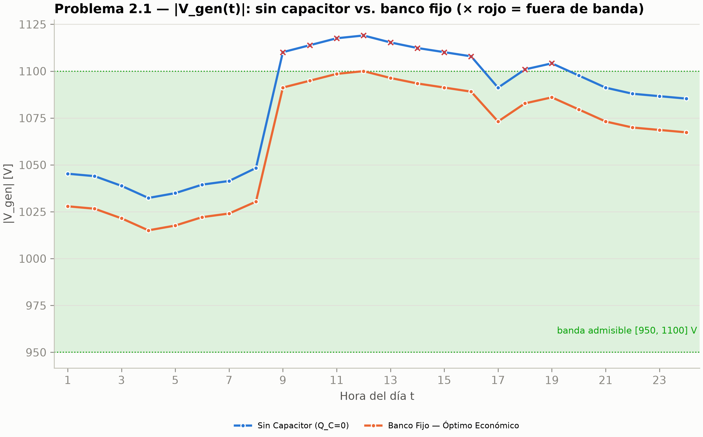

**Comentario técnico:** Sin capacitor quedan fuera de banda 10 horas (9–16 y 18–19), todas por encima de 1100 V; la mayor violación es de 19.03 V. Son las horas con la industria en servicio y mayor demanda reactiva. A 66 kV sí existe un banco fijo que cumple las 24 horas: la intersección de las ventanas horarias es [87.248, 1530.469] kvar. La cota inferior la impone la hora 12, la de mayor carga. El mínimo libre de J está en 85.76 kvar y queda 1.49 kvar por debajo de la ventana: dejaría 1 hora fuera por 0.31 V. Como J es convexa, el banco de menor costo que cumple es el extremo inferior de la ventana, 87.2481 kvar, que se adopta como **87.25 kvar**. Con Qc = 87.25 kvar, \|Vgen\| queda entre 1,015.06 V (hora 4) y 1,100.00 V (hora 12): **24 de 24 horas en banda**. La hora 12 queda a 0.0004 V del límite superior; el límite inferior tiene 65.1 V de holgura. Exigir la banda cuesta $ 9.694 COP por año frente al mínimo libre de J: la restricción de tensión y el criterio económico prácticamente coinciden.

#### Fig. 18. Problema 2.1 — |I_line(t)|

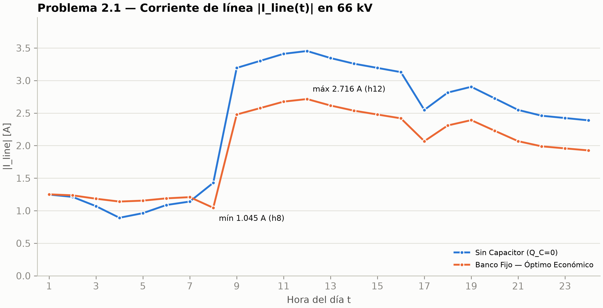

**Comentario técnico:** Sin capacitor, \|Iline\| va de 0.8913 A (hora 4) a 3.4537 A (hora 12), con promedio de 2.3393 A. Con Qc = 87.25 kvar va de 1.0445 A (hora 8) a 2.7158 A (hora 12); el máximo baja 21.4 % y el promedio 16.6 % (queda en 1.9519 A). El perfil conserva la forma de la demanda: el banco reduce la corriente en las horas de mayor carga y la aumenta en 7 horas valle (1–7), donde entrega más reactiva de la que pide la carga.

#### Fig. 19. Problema 2.1 — pérdidas apiladas línea vs. generador

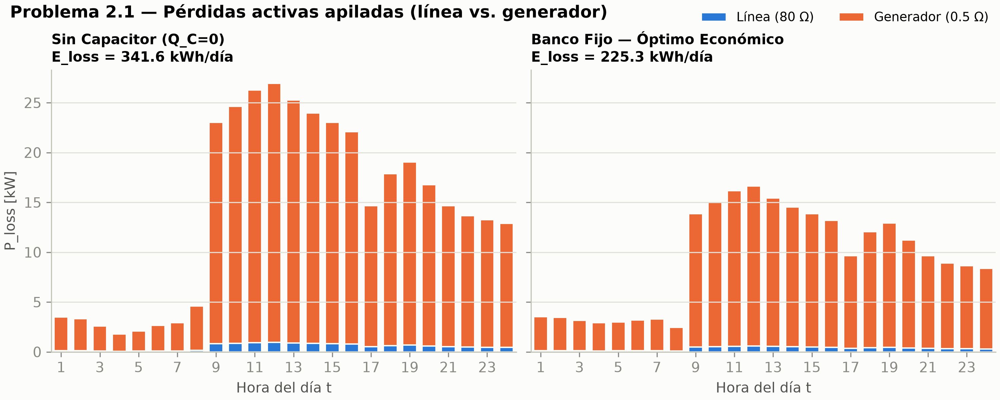

**Comentario técnico:** Con Qc = 87.25 kvar las pérdidas van de 2.464 kW (hora 8) a 16.654 kW (hora 12); en esa hora 16.064 kW se disipan en el generador y 0.590 kW en la línea. Las pérdidas reactivas de la línea van de 0.982 a 6.638 kvar. Energía perdida: **225.27 kWh/día** (217.29 en el generador y 7.98 en la línea) = 82,224 kWh/año, frente a 341.64 kWh/día sin capacitor (-34.1 %). Equivale al 7.87 % de la energía entregada. Costo de las pérdidas: $ 216.261 COP por día y **$ 78.935.102 COP por año** (sin capacitor: $ 119.710.744 COP). El banco cuesta $ 8.725.000 COP y ahorra $ 40.775.643 COP por año: payback de **78.1 días** y ROI de 367 % / 1,302 % / 2,237 % a 1, 3 y 5 años. El costo total anual J queda en **$ 87.660.102 COP**. Límite del nivel de tensión: como el 96.46 % de las pérdidas está en la resistencia del generador (lado de 1 kV), subir aún más la tensión de la línea solo podría recuperar el 3.54 % restante.

#### Fig. 20. Problema 2.1 — costo total anual J(Q_C)

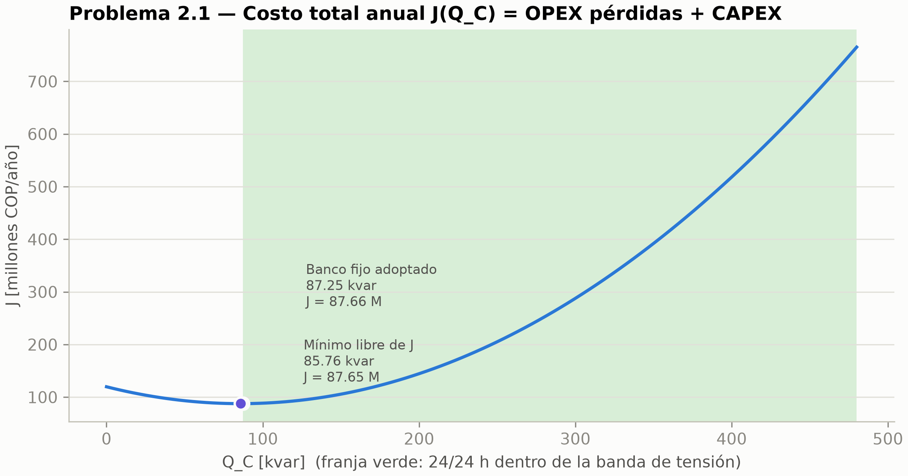

**Comentario técnico:** A 66 kV el mínimo libre de J (85.76 kvar) y el banco que cumple la banda (87.25 kvar) están a 1.49 kvar: la curva es casi plana entre ambos y exigir tensión cuesta $ 9.694 COP/año. La franja verde (Q_C con 24/24 h en banda) empieza en 87.25 kvar.

#### Fig. 21. Problema 2.1 — mapa de factibilidad horaria

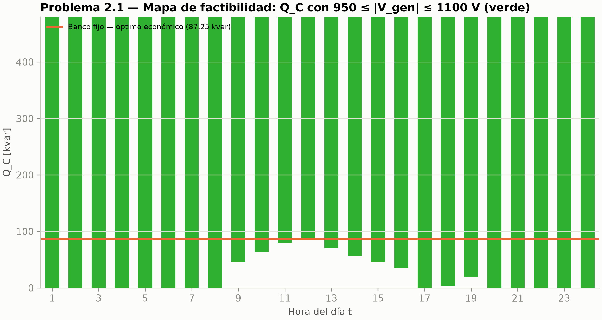

**Comentario técnico:** Las ventanas horarias se solapan: intersección [87.248, 1530.469] kvar. Las horas valle admiten cualquier Q_C desde 0; las horas con la industria en servicio exigen un mínimo, y el mayor de esos mínimos (hora de mayor carga) fija el banco en 87.25 kvar.

#### Fig. 22. Problema 2.1 — fp_neto(t) y Q_neto(t)

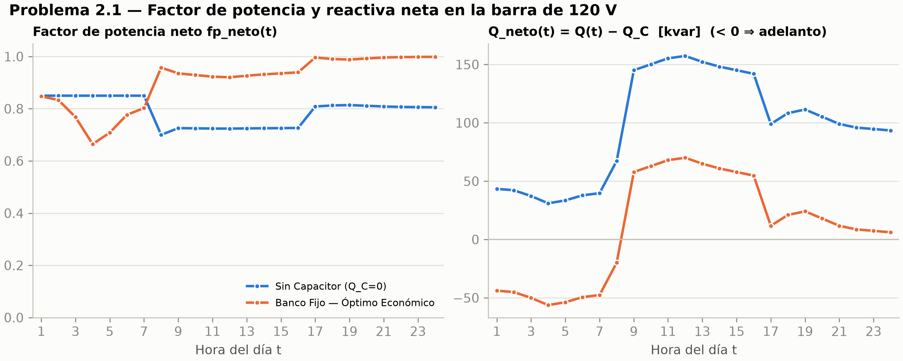

**Comentario técnico:** Sin capacitor el fp neto es el de la carga: 0.700 a 0.850, en atraso. Con Qc = 87.25 kvar hay 16 horas en atraso con fp entre 0.921 y 0.999, y 8 horas en adelanto (1–8) con fp entre 0.664 y 0.957. El adelanto aparece porque el banco es fijo: 87.25 kvar superan la demanda reactiva de las horas valle (mínimo 31.0 kvar). En las horas pico compensa 55 % de la reactiva y el fp sube de 0.724 a 0.921.

#### Fig. 23. Comparación — Problema 2 vs. Problema 2.1

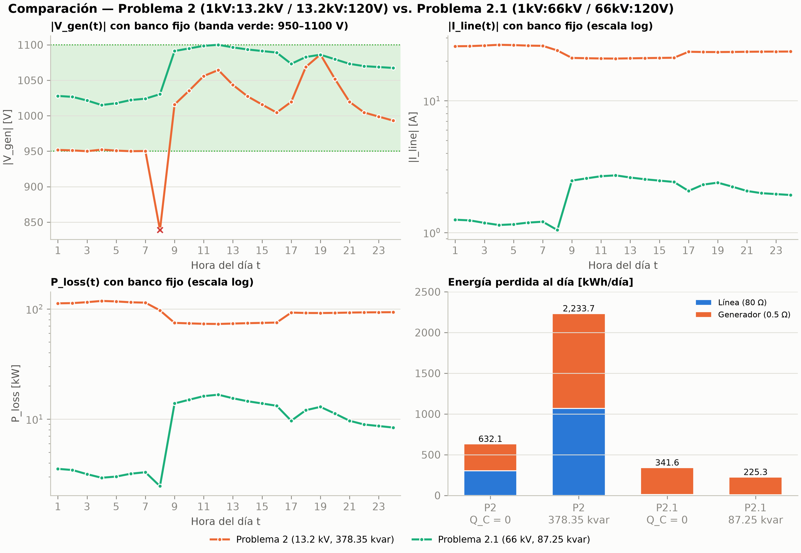

**Comentario técnico:** **Banco.** A 13.2 kV ningún banco fijo cumple las 24 horas y el de máximo cumplimiento es de 378.35 kvar (23/24 h). A 66 kV basta un banco de **87.25 kvar** (0.23 veces el anterior) para cumplir **24/24 h**. **Corriente de línea.** Para la misma carga se divide por 5 (sin capacitor: 17.269 A → 3.454 A). Con cada banco, el máximo pasa de 26.587 A a 2.716 A (÷9.8) y el promedio de 23.510 A a 1.952 A, porque a 13.2 kV el banco sobrecompensa y a 66 kV no. **Tensión del generador.** Sin capacitor el máximo baja de 2,092 V a 1,119 V. Con banco, a 13.2 kV \|Vgen\| queda en 839–1,086 V con 1 hora fuera; a 66 kV en 1,015–1,100 V sin horas fuera. **Pérdidas.** Con banco pasan de 2,233.7 a 225.3 kWh/día (÷9.9). Sin capacitor la mejora es menor, de 632.1 a 341.6 kWh/día (÷1.85): elevar la tensión solo reduce la parte de la línea, y la del generador pasa de 52.1 % a 96.5 % del total.

## 8. Desarrollo Matemático Paso a Paso — Fase 2 (Problema 2)

Cadena de cálculo de la Fase 2 (T1, línea, T2 y banco Q_C) contrastada con la Fase 1 (red directa). Relaciones:
I_line = I_load / a₂, I_gen = n₁·I_line, V_line,recv = 120·110 = 13 200∠0° V, V_T1,prim = V_line,envío / n₁ y
R_eq referida al lado de 13.2 kV = 80 + 0.5·13.2² = **167.12 Ω**. La conservación de potencia
compleja se verifica de forma independiente (V_gen·I_gen* frente a S_neto + S_loss,line + S_loss,gen).
La tabla horaria completa de las 24 h está en `fase2_paso_a_paso_24h_qc0.csv`,
`fase2_paso_a_paso_24h_fijo_economico.csv` y `fase1_paso_a_paso_24h.csv`.

### 8.1 Hora 1 (contraste con el cálculo manual de la Fase 1)

**Datos de la hora 1:** P₁ = 70 kW (fp 0.85 en atraso) → Q₁ = 70·tan(cos⁻¹ 0.85) = 43.3821 kvar; P₂ = 0 kW (fp 0.75 en atraso) → Q₂ = 0.0000 kvar.  
S_carga = 70.0000 + j43.3821 = 82.3529∠31.7883° kVA · fp carga 0.850 (en atraso).

| Magnitud | Expresión | Fase 1 (red directa) | Fase 2, Q_C = 0 | Fase 2, Q_C = 378.35 kvar |
|---:|---:|---:|---:|---:|
| Q_C | banco en la barra de 120 V | 0.0000 kvar | 0.0000 kvar | 378.3500 kvar |
| S_neto | P_tot + j(Q_tot − Q_C) | 70.0000 + j43.3821 = 82.3529∠31.7883° kVA | 70.0000 + j43.3821 = 82.3529∠31.7883° kVA | 70.0000 − j334.9679 = 342.2039∠-78.1965° kVA |
| fp_neto | P / \|S_neto\| | 0.850 (en atraso) | 0.850 (en atraso) | 0.205 (en adelanto — sobrecompensado) |
| I_load | (S_neto·1000 / 120∠0°)* | 583.3333 − j361.5175 = 686.2745∠-31.7883° A | 583.3333 − j361.5175 = 686.2745∠-31.7883° A | 583.3333 + j2,791.3991 = 2,851.6990∠78.1965° A |
| I_line | Fase 1: I_load · Fase 2: I_load / a₂ (110) | 583.333333 − j361.517531 = 686.274510∠-31.7883° A | 5.303030 − j3.286523 = 6.238859∠-31.7883° A | 5.303030 + j25.376356 = 25.924536∠78.1965° A |
| I_gen | Fase 1: I_line · Fase 2: n₁·I_line (13.2) | 583.3333 − j361.5175 = 686.2745∠-31.7883° A | 70.0000 − j43.3821 = 82.3529∠-31.7883° A | 70.0000 + j334.9679 = 342.2039∠78.1965° A |
| V_line,envío | V_recv + I_line·(80 + j900) | 372,152.444 + j496,078.598 = 620,154.349∠53.1232° V | 16,582.113 + j4,509.805 = 17,184.435∠15.2146° V | -9,214.478 + j6,802.836 = 11,453.610∠143.5624° V |
| V_T1,prim | V_line,envío / n₁ | — (sin T1) | 1,256.221 + j341.652 = 1,301.851∠15.2146° V | -698.066 + j515.366 = 867.698∠143.5624° V |
| V_gen | V_T1,prim + 0.5·I_gen | 372,444.111 + j495,897.839 = 620,184.878∠53.0916° V | 1,291.221 + j319.961 = 1,330.273∠13.9174° V | -663.066 + j682.850 = 951.810∠134.1579° V |
| P_loss,line | \|I_line\|²·80 / 1000 | 37,677.816225 kW | 3.113869 kW | 53.766525 kW |
| P_loss,gen | \|I_gen\|²·0.5 / 1000 | 235.486351 kW | 3.391003 kW | 58.551746 kW |
| P_loss,total | suma (Fase 2: \|I_line\|²·167.12/1000) | 37,913.302576 kW | 6.504873 kW | 112.318271 kW |
| S_gen = V_gen·I_gen* | debe igualar S_neto + S_loss,line + S_loss,gen | 37,983.3026 + j423,918.8146 = 425,617.0728∠84.8799° kVA | 76.5049 + j78.4131 = 109.5519∠45.7057° kVA | 182.3183 + j269.9055 = 325.7130∠55.9614° kVA |
| Error relativo de conservación | \|S_gen − Σ\| / \|S_gen\| | 1.5e-16 | 3.7e-16 | 5.3e-16 |

### 8.2 Hora 8 (fuera de banda con el banco fijo)

**Datos de la hora 8:** P₁ = 66 kW (fp 0.70 en atraso) → Q₁ = 66·tan(cos⁻¹ 0.70) = 67.3335 kvar; P₂ = 0 kW (fp 0.75 en atraso) → Q₂ = 0.0000 kvar.  
S_carga = 66.0000 + j67.3335 = 94.2857∠45.5730° kVA · fp carga 0.700 (en atraso).

| Magnitud | Expresión | Fase 1 (red directa) | Fase 2, Q_C = 0 | Fase 2, Q_C = 378.35 kvar |
|---:|---:|---:|---:|---:|
| Q_C | banco en la barra de 120 V | 0.0000 kvar | 0.0000 kvar | 378.3500 kvar |
| S_neto | P_tot + j(Q_tot − Q_C) | 66.0000 + j67.3335 = 94.2857∠45.5730° kVA | 66.0000 + j67.3335 = 94.2857∠45.5730° kVA | 66.0000 − j311.0165 = 317.9423∠-78.0191° kVA |
| fp_neto | P / \|S_neto\| | 0.700 (en atraso) | 0.700 (en atraso) | 0.208 (en adelanto — sobrecompensado) |
| I_load | (S_neto·1000 / 120∠0°)* | 550.0000 − j561.1122 = 785.7143∠-45.5730° A | 550.0000 − j561.1122 = 785.7143∠-45.5730° A | 550.0000 + j2,591.8044 = 2,649.5189∠78.0191° A |
| I_line | Fase 1: I_load · Fase 2: I_load / a₂ (110) | 550.000000 − j561.112234 = 785.714286∠-45.5730° A | 5.000000 − j5.101020 = 7.142857∠-45.5730° A | 5.000000 + j23.561858 = 24.086535∠78.0191° A |
| I_gen | Fase 1: I_line · Fase 2: n₁·I_line (13.2) | 550.0000 − j561.1122 = 785.7143∠-45.5730° A | 66.0000 − j67.3335 = 94.2857∠-45.5730° A | 66.0000 + j311.0165 = 317.9423∠78.0191° A |
| V_line,envío | V_recv + I_line·(80 + j900) | 549,121.010 + j450,111.021 = 710,023.813∠39.3413° V | 18,190.918 + j4,091.918 = 18,645.463∠12.6773° V | -7,605.673 + j6,384.949 = 9,930.449∠139.9866° V |
| V_T1,prim | V_line,envío / n₁ | — (sin T1) | 1,378.100 + j309.994 = 1,412.535∠12.6773° V | -576.187 + j483.708 = 752.307∠139.9866° V |
| V_gen | V_T1,prim + 0.5·I_gen | 549,396.010 + j449,830.465 = 710,058.747∠39.3097° V | 1,411.100 + j276.327 = 1,437.901∠11.0797° V | -543.187 + j639.216 = 838.839∠130.3569° V |
| P_loss,line | \|I_line\|²·80 / 1000 | 49,387.755102 kW | 4.081633 kW | 46.412894 kW |
| P_loss,gen | \|I_gen\|²·0.5 / 1000 | 308.673469 kW | 4.444898 kW | 50.543642 kW |
| P_loss,total | suma (Fase 2: \|I_line\|²·167.12/1000) | 49,696.428571 kW | 8.526531 kW | 96.956536 kW |
| S_gen = V_gen·I_gen* | debe igualar S_neto + S_loss,line + S_loss,gen | 49,762.4286 + j555,679.5784 = 557,903.3009∠84.8827° kVA | 74.5265 + j113.2518 = 135.5735∠56.6527° kVA | 162.9565 + j211.1285 = 266.7022∠52.3378° kVA |
| Error relativo de conservación | \|S_gen − Σ\| / \|S_gen\| | 2.2e-16 | 1.0e-16 | 2.4e-16 |

### 8.3 Hora 12 (hora pico)

**Datos de la hora 12:** P₁ = 85 kW (fp 0.70 en atraso) → Q₁ = 85·tan(cos⁻¹ 0.70) = 86.7173 kvar; P₂ = 80 kW (fp 0.75 en atraso) → Q₂ = 70.5534 kvar.  
S_carga = 165.0000 + j157.2707 = 227.9453∠43.6261° kVA · fp carga 0.724 (en atraso).

| Magnitud | Expresión | Fase 1 (red directa) | Fase 2, Q_C = 0 | Fase 2, Q_C = 378.35 kvar |
|---:|---:|---:|---:|---:|
| Q_C | banco en la barra de 120 V | 0.0000 kvar | 0.0000 kvar | 378.3500 kvar |
| S_neto | P_tot + j(Q_tot − Q_C) | 165.0000 + j157.2707 = 227.9453∠43.6261° kVA | 165.0000 + j157.2707 = 227.9453∠43.6261° kVA | 165.0000 − j221.0793 = 275.8642∠-53.2646° kVA |
| fp_neto | P / \|S_neto\| | 0.724 (en atraso) | 0.724 (en atraso) | 0.598 (en adelanto — sobrecompensado) |
| I_load | (S_neto·1000 / 120∠0°)* | 1,375.0000 − j1,310.5893 = 1,899.5445∠-43.6261° A | 1,375.0000 − j1,310.5893 = 1,899.5445∠-43.6261° A | 1,375.0000 + j1,842.3274 = 2,298.8682∠53.2646° A |
| I_line | Fase 1: I_load · Fase 2: I_load / a₂ (110) | 1,375.000000 − j1,310.589279 = 1,899.544487∠-43.6261° A | 12.500000 − j11.914448 = 17.268586∠-43.6261° A | 12.500000 + j16.748431 = 20.898802∠53.2646° A |
| I_gen | Fase 1: I_line · Fase 2: n₁·I_line (13.2) | 1,375.0000 − j1,310.5893 = 1,899.5445∠-43.6261° A | 165.0000 − j157.2707 = 227.9453∠-43.6261° A | 165.0000 + j221.0793 = 275.8642∠53.2646° A |
| V_line,envío | V_recv + I_line·(80 + j900) | 1,289,650.351 + j1,132,652.858 = 1,716,420.847∠41.2917° V | 24,923.003 + j10,296.844 = 26,966.295∠22.4478° V | -873.588 + j12,589.874 = 12,620.146∠93.9693° V |
| V_T1,prim | V_line,envío / n₁ | — (sin T1) | 1,888.106 + j780.064 = 2,042.901∠22.4478° V | -66.181 + j953.778 = 956.072∠93.9693° V |
| V_gen | V_T1,prim + 0.5·I_gen | 1,290,337.851 + j1,131,997.563 = 1,716,505.244∠41.2601° V | 1,970.606 + j701.429 = 2,091.720∠19.5930° V | 16.319 + j1,064.318 = 1,064.443∠89.1216° V |
| P_loss,line | \|I_line\|²·80 / 1000 | 288,661.540691 kW | 23.856326 kW | 34.940795 kW |
| P_loss,gen | \|I_gen\|²·0.5 / 1000 | 1,804.134629 kW | 25.979539 kW | 38.050525 kW |
| P_loss,total | suma (Fase 2: \|I_line\|²·167.12/1000) | 290,465.675321 kW | 49.835864 kW | 72.991320 kW |
| S_gen = V_gen·I_gen* | debe igualar S_neto + S_loss,line + S_loss,gen | 290,630.6753 + j3,247,599.6035 = 3,260,578.0736∠84.8862° kVA | 214.8359 + j425.6544 = 476.7978∠63.2191° kVA | 237.9913 + j172.0047 = 293.6417∠35.8570° kVA |
| Error relativo de conservación | \|S_gen − Σ\| / \|S_gen\| | 1.4e-16 | 0.0e+00 | 2.2e-16 |

## 9. Auditoría independiente

`scripts/auditoria_independiente.py` recalcula las 24 horas con Q_C = 378.35 kvar sin importar `src/` (solo la
biblioteca estándar) por dos caminos —tramo a tramo y con la impedancia reflejada al generador— y comprueba la
conservación de potencia compleja, la invariancia de potencia en T1 y T2, la fórmula de pérdidas, las cuentas
económicas, el mínimo libre de J y la ventana de máximo cumplimiento de tensión; al final contrasta sus valores con
`p2_sin_capacitor_horario.csv` y `p2_fijo_economico_horario.csv`. El resultado queda en `auditoria_qc_fijo.txt` y
`auditoria_qc_fijo_24h.csv`. El mismo programa audita el Problema 2.1 (línea a 66 kV) y **deduce por su cuenta el
banco de cada caso** a partir de la ventana de máximo cumplimiento de tensión y del mínimo de J dentro de ella
(`auditoria_p21.txt`, `auditoria_p21_24h.csv`).

## 10. Sensibilidad (X_line)

- Rangos de X_line con banco **fijo** factible las 24 h: **[66.159, 777.543] Ω**.
- X_line crítica (al reducir desde 900 Ω): **777.5429 Ω**. Con la reactancia real (900 Ω) ningún banco fijo cumple las 24 h; por eso el banco adoptado cumple 23/24.

## 11. Gráficas y comentarios técnicos

### 1. Problema 1 — |I_line(t)|

**Comentario técnico:** A 120 V la corriente alcanza 1,900 A en la hora pico. Para transportar ~150 kW a baja tensión se requieren corrientes de miles de amperios; con 80 Ω de resistencia serie esto es físicamente inviable.

### 2. Problema 1 — P_loss(t) vs. P útil

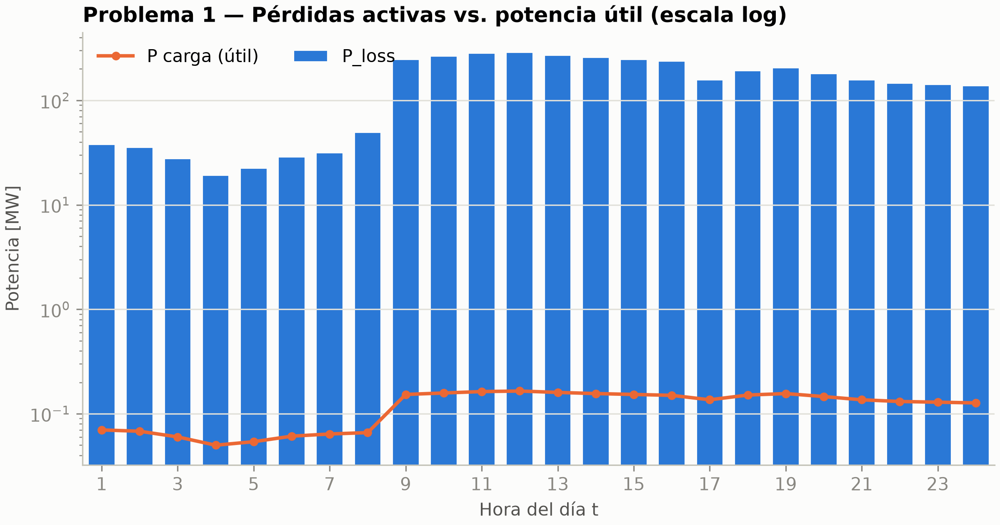

**Comentario técnico:** Las pérdidas diarias (3,684,396 kWh) superan 1,287 veces la energía entregada. La relación P_loss ∝ \|I\|²·R explica el diagnóstico de 'pérdidas absurdas'.

### 3. Problema 1 — |S_gen(t)|

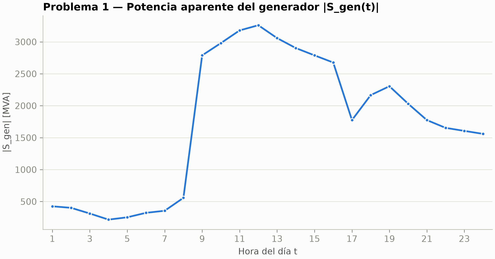

**Comentario técnico:** La potencia aparente del generador (miles de MVA) está dominada por Q_loss = \|I\|²·900; el generador alimenta principalmente la reactancia de la línea, no la carga.

### 4. Perfil de demanda

**Comentario técnico:** La carga industrial (fp 0.75) entra de 9 a 24 h y domina la demanda reactiva; el bloque 8–16 h residencial (fp 0.70) agrava el consumo de vars.

### 5. Problema 1 vs. Problema 2 — corriente

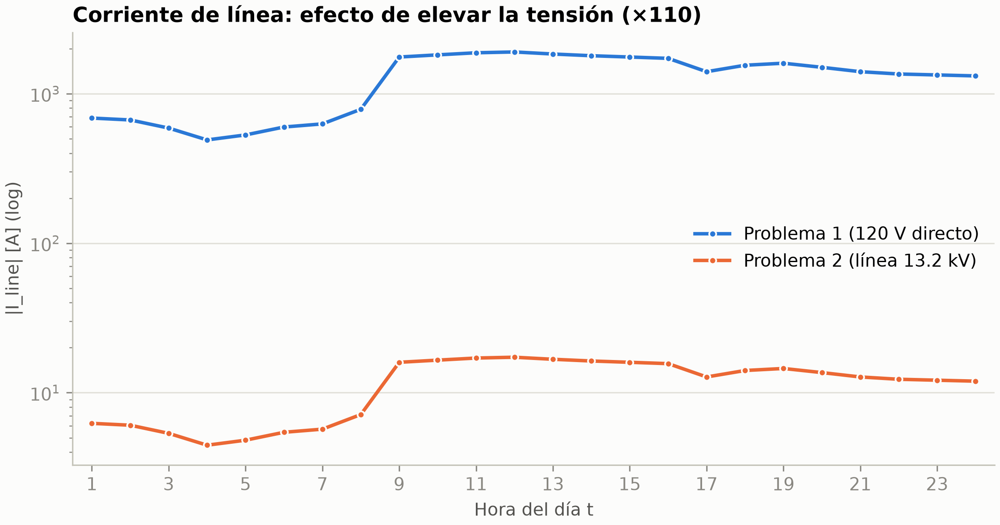

**Comentario técnico:** Al elevar la tensión de transporte a 13.2 kV la corriente de línea cae por el factor a₂ = 110 y las pérdidas por 110² = 12 100.

### 6. |V_gen(t)| — sin capacitor vs. banco fijo

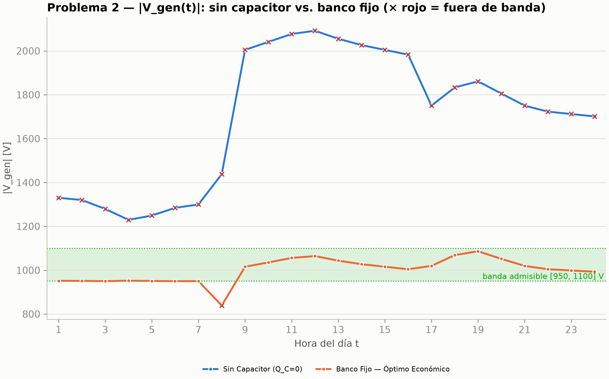

**Comentario técnico:** Sin capacitor, \|Vgen\| va de 1,229.4 V a 2,091.7 V y está por encima de 1100 V las 24 horas: con corriente en atraso la caída en j900 Ω se suma a la tensión de la carga. Con Qc = 378.35 kvar, \|Vgen\| queda entre 838.84 V y 1,086.37 V y **23 de 24 horas** entran en la banda [950, 1100] V. Horas valle (1–7): \|Vgen\| queda pegado al límite inferior, entre 950.00 V y 952.22 V. El margen mínimo es de 0.0042 V en la hora 6: esa hora es la que fija el tamaño del banco, y con un kvar menos saldría de la banda. Horas pico: el máximo es 1,086.37 V en la hora 19, a 13.63 V del límite superior. **Hora 8, fuera de banda:** \|Vgen\| = 838.84 V, 111.16 V por debajo de 950 V. Esa hora solo admite Qc en [70.933, 104.320] ∪ [404.641, 438.028] kvar; 378.35 kvar cae en el hueco entre sus dos tramos, donde la sobrecompensación hunde la tensión. Ningún banco fijo cumple las 24 horas (intersección ∅). El máximo alcanzable es 23/24 horas, con Qc en [378.349, 384.847] kvar; 378.35 kvar es el extremo de menor costo de esa ventana. El banco supera la demanda reactiva en las 24 horas (Q de la carga máx. 157.3 kvar): el flujo neto es capacitivo, de -221.1 kvar a -347.4 kvar, y el factor de potencia neto queda **en adelanto entre 0.142 y 0.598**. La banda se alcanza precisamente por esa sobrecompensación.

### 7. Pérdidas apiladas línea vs. generador

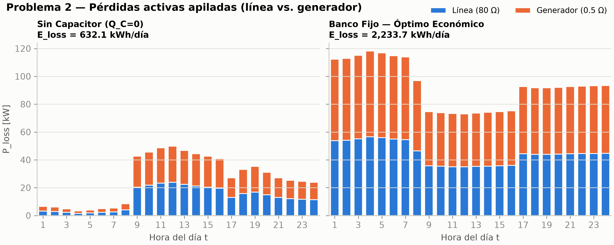

**Comentario técnico:** El reparto es el mismo en todas las horas: 52.13 % en la resistencia del generador (0.5 Ω, que referida a 13.2 kV vale 87.12 Ω) y 47.87 % en los 80 Ω de la línea. Con Qc = 378.35 kvar las pérdidas van de 72.99 kW (hora 12) a 118.13 kW (hora 4); en esa hora se pierden 118.1 kW para entregar 50 kW. Sin capacitor van de 3.32 kW a 49.84 kW. Energía perdida al día: **2,233.73 kWh** (1,069.28 en la línea y 1,164.45 en el generador) frente a 632.14 kWh sin capacitor: ×3.53. Equivale al 78.0 % de la energía entregada. Costo de las pérdidas: $ 2.144.377 COP por día y **$ 782.697.716 COP por año** (sin capacitor: $ 221.501.988 COP por año). Con el banco ($ 37.835.000 COP) el costo total anual es **$ 820.532.716 COP**. El banco no se paga con ahorro de pérdidas: frente a Qc = 0 las pérdidas cuestan $ 561.195.727 COP más por año. Lo que compra es regulación de tensión (23/24 horas en banda frente a 0/24). El mínimo de J sin exigir tensión está en 91.03 kvar ($ 154.664.177 COP por año), pero deja 23 horas fuera de banda.

### 8. Costo total anual J(Q_C)

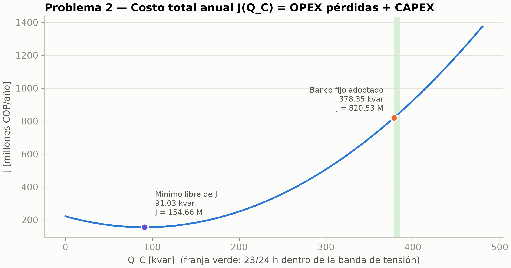

**Comentario técnico:** J(Q_C) es una parábola convexa con mínimo libre en 91.03 kvar ($ 154.664.177 COP/año). El banco adoptado (378.35 kvar) está en la rama creciente: J = $ 820.532.716 COP/año, 5.31 veces el mínimo libre. La franja verde marca los Q_C con 23/24 h en banda; 378.35 kvar es su extremo de menor costo.

### 9. Mapa de factibilidad horaria

**Comentario técnico:** Las ventanas verdes no comparten un valor común (par crítico: horas (8, 19)). La línea de 378.35 kvar cruza la rama alta de todas las horas menos la 8, donde cae en el hueco entre sus dos tramos.

### 10. Horas en banda según Q_C

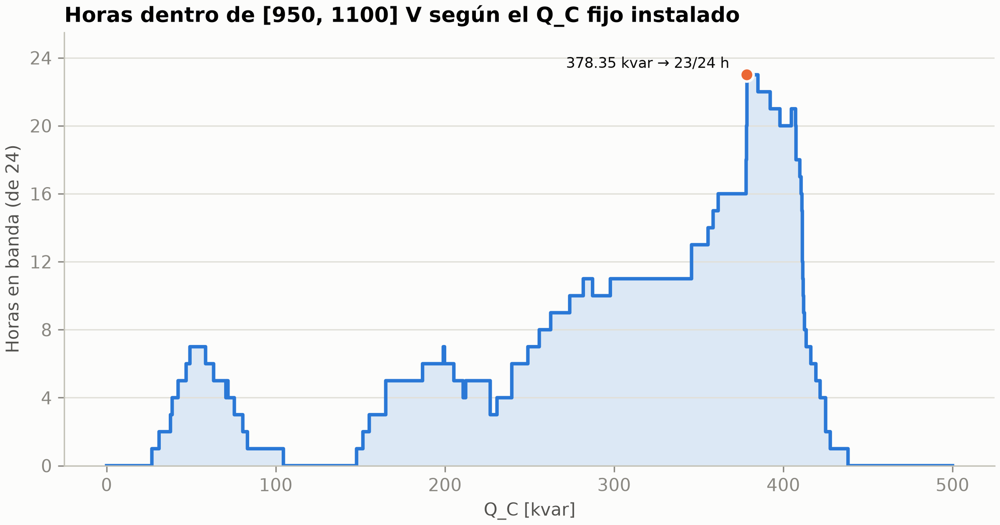

**Comentario técnico:** El número de horas con 950 ≤ \|V_gen\| ≤ 1100 V alcanza su máximo, 23/24, para Q_C en [378.349, 384.847] kvar. Por debajo de 378.35 kvar las horas valle quedan bajo 950 V; por encima del extremo superior salen las horas pico de la tarde.

### 11. Triángulo de potencias (h12)

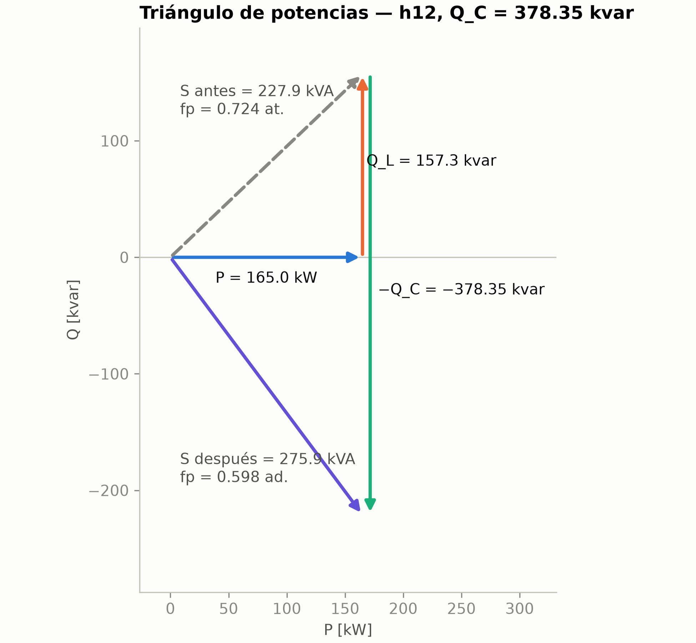

**Comentario técnico:** En la hora 12 la carga pide 157.27 kvar y el banco entrega 378.35 kvar: Q_neto = -221.08 kvar y fp = 0.598 en adelanto. La potencia aparente sube de 227.9 a 275.9 kVA.

### 12. Diagrama fasorial (h12)

**Comentario técnico:** Con corriente en atraso la caída jI·X (900 Ω) es casi paralela a V₀ y eleva \|V_gen\|; con corriente en adelanto gira y \|V_gen\| vuelve a la banda (1,064.4 V frente a 2,091.7 V sin capacitor).

### 13. Flujo de caja acumulado

**Comentario técnico:** Frente a Q_C = 0 el banco de 378.35 kvar cuesta $ 37.835.000 COP y aumenta el costo de pérdidas en $ 561.195.727 COP/año: el flujo acumulado es siempre negativo y la inversión no se recupera con ahorro de energía.

### 14. Sensibilidad X_line

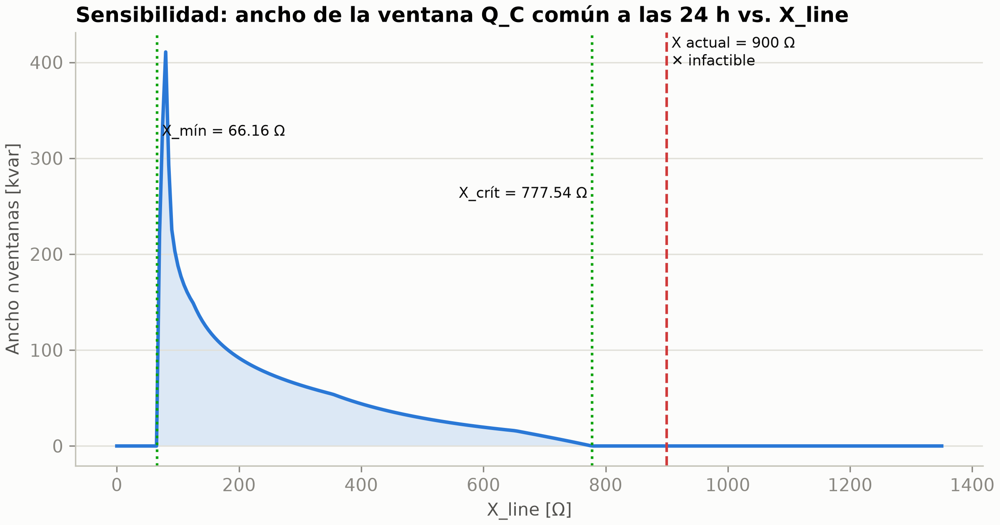

**Comentario técnico:** La factibilidad del banco fijo no es monótona en X: con X muy baja el capacitor pierde poder de regulación y con X alta la dispersión valle-pico excede la banda.

### 15. Problema 2 — |I_line(t)|

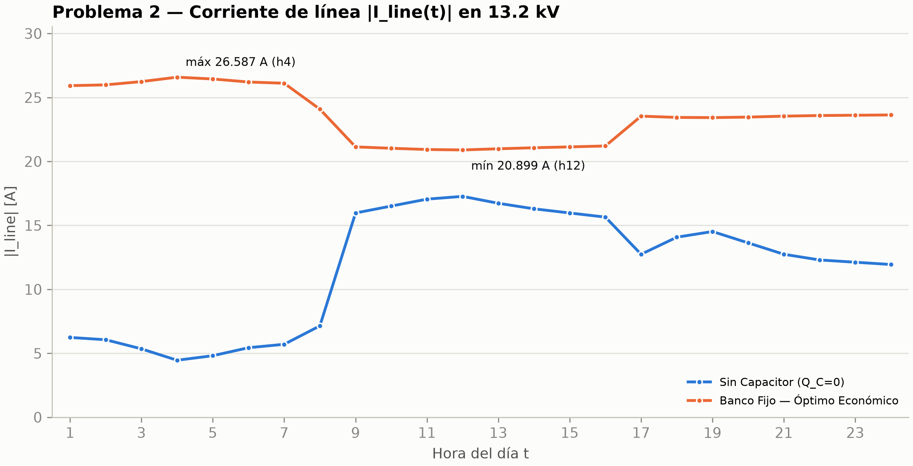

**Comentario técnico:** Sin capacitor, \|Iline\| sigue a la carga: mínimo 4.456 A (hora 4) y máximo 17.269 A (hora 12). Con Qc = 378.35 kvar el perfil se invierte: máximo 26.587 A en la hora 4 (la de menor carga) y mínimo 20.899 A en la hora 12 (la de mayor carga). La corriente la domina el excedente capacitivo \|Q − Qc\|, que es mayor cuanto menos reactiva pide la carga. La corriente sube en las 24 horas: el promedio pasa de 11.696 A a 23.510 A (×2.01) y el máximo de 17.269 A a 26.587 A (×1.54). Aun así es 71 veces menor que el máximo del Problema 1.

### 16. Problema 2 — fp_neto(t) y Q_neto(t)

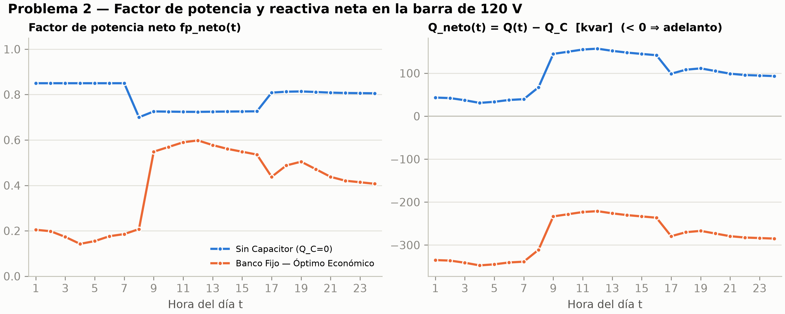

**Comentario técnico:** Sin capacitor el fp neto es el de la carga (0.700–0.850, en atraso). Con 378.35 kvar Q_neto es negativo las 24 horas y el fp cae a 0.142–0.598 en adelanto; el peor valor es el de la hora de menor carga.

## 12. Guion de exposición (10 minutos)

| Tiempo | Bloque | Mensaje clave | Apoyo |
|---|---|---|---|
| 0:00–1:00 | Contexto | Red de 24 h con carga residencial + industrial, 80 + j900 Ω de línea y restricción de tensión en el generador. | Fig. 4 |
| 1:00–2:30 | Problema 1 | Golden test hora 1: 686.27 A, 37,913 kW de pérdidas para servir 70 kW. Pérdidas ×1,287 la energía útil. | Fig. 1–3 |
| 2:30–3:30 | Transformadores | Elevar a 13.2 kV divide I por 110 y las pérdidas por 12 100. R_gen referida = 87.12 Ω ⇒ R_eq = 167.12 Ω. | Fig. 5 |
| 3:30–4:30 | Problema de tensión | Sin capacitor \|V_gen\| llega a 2,092 V: la caída jI·X en 900 Ω eleva la tensión de envío. | Fig. 6, 12 |
| 4:30–6:00 | Factibilidad | Análisis cuadrático exacto: ventanas horarias disjuntas (par (8, 19)) ⇒ ningún banco fijo cumple las 24 h; el máximo es 23/24. | Fig. 9, 10 |
| 6:00–7:30 | Banco fijo | Q_C = 378.35 kvar: 23/24 h en banda, \|V_gen\| ∈ [839, 1086] V; fuera la hora 8. | Fig. 6, 15 |
| 7:30–8:45 | Costo | CAPEX $ 37.835.000 COP; pérdidas 2,234 kWh/día (×3.53); J = $ 820.532.716 COP/año. El mínimo libre de J (91.03 kvar) no regula tensión. | Fig. 7, 8, 13 |
| 8:45–9:30 | fp neto | El banco sobrecompensa: fp en adelanto 0.142–0.598 las 24 h. Regular tensión con esta línea exige adelanto. | Fig. 11, 16 |
| 9:30–10:00 | Cierre | Sensibilidad: con X ≤ 777.5 Ω un banco fijo cumpliría las 24 h. Demo del dashboard. | Fig. 14, demo |
